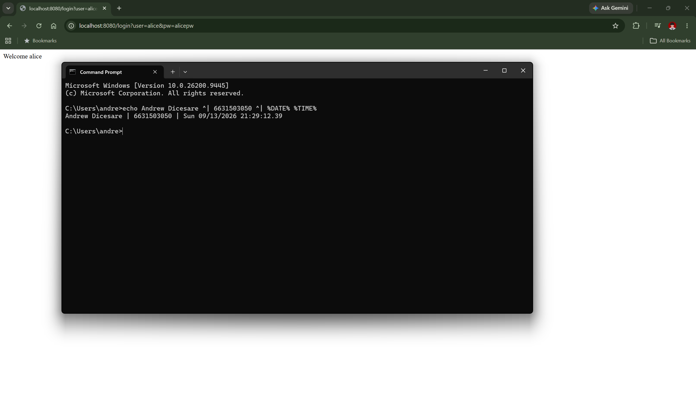
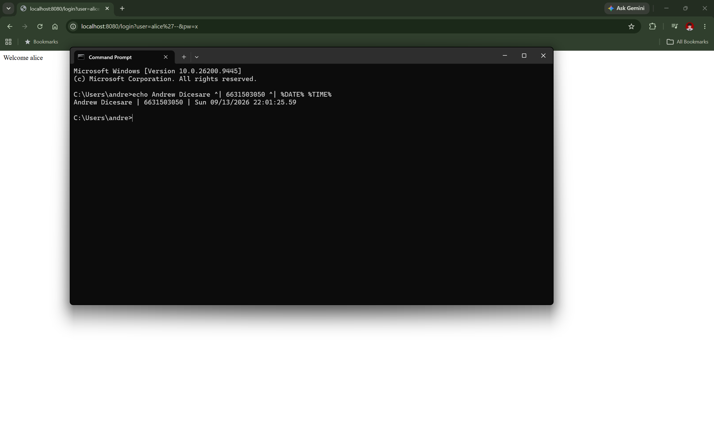
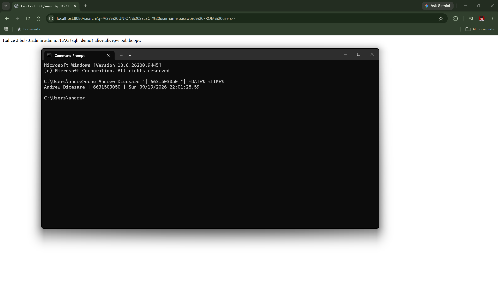
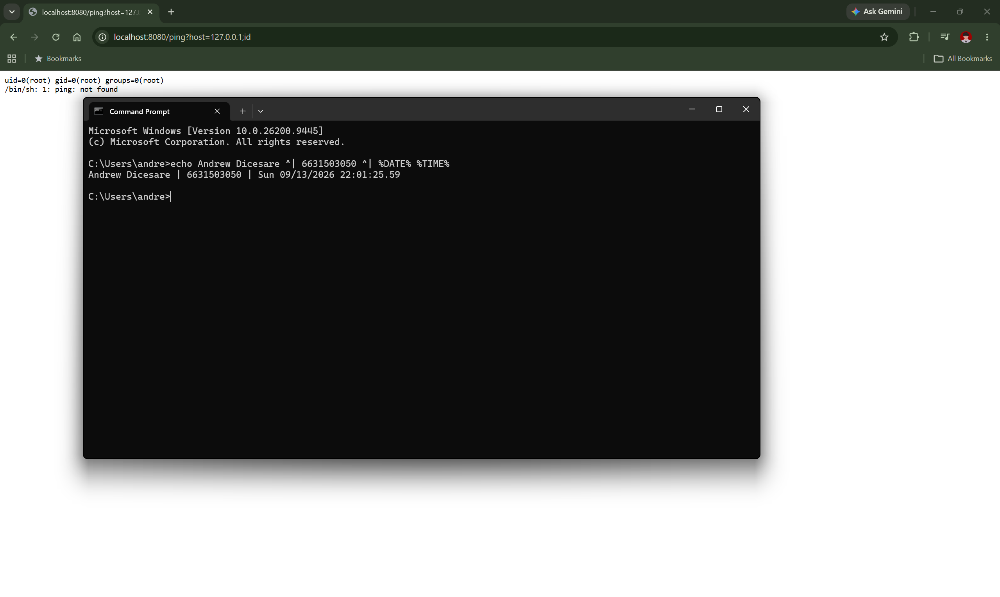
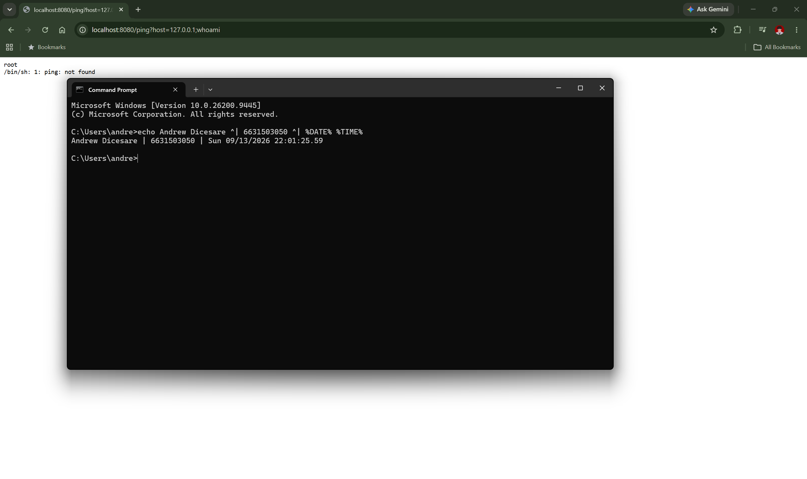
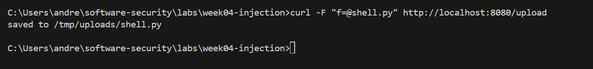
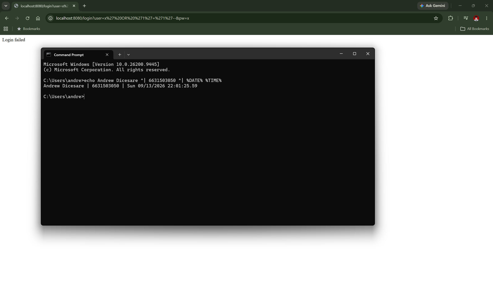
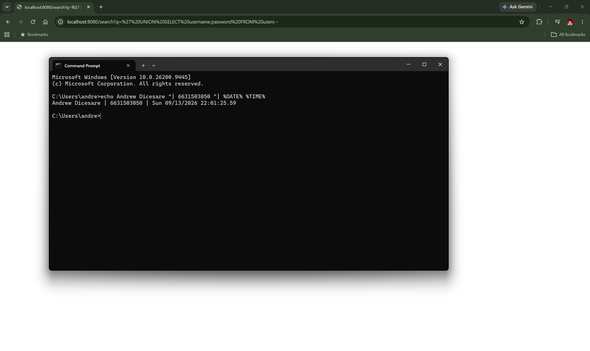
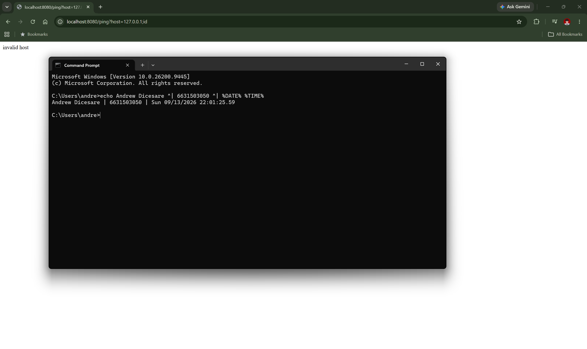

# Worksheet 4 — Injection & Input Handling (3 hrs)

> **Course:** Software Security (KOSEN69) · **Week 4**
> **Aligned:** OWASP 2025 **A05 Injection** · **CWE-89** (SQLi), **CWE-78** (OS command injection), **CWE-434** (unrestricted upload)
> **Signature game:** 🐉 **SQLi Boss Fight** — each successful injection lands a "hit" on the boss; the boss falls when you dump every credential and land an RCE.

> ⚠️ **Ethics note:** All payloads here are for the provided sandbox (`vulnerable_app.py`) and your own DVWA/Juice Shop containers **only**. Never test systems you do not own or have written permission to test. Unauthorized injection is a crime under most computer-misuse laws.

## Part 1 — Student Information

| Name | Student ID | Date | Group | AI use disclosed |
|------|-----------|------|-------|------------------|
| Andrew Dicesare | 6631503050 | 9/13/2026 | Let me eat | Yes — used an AI assistant for the *Audit the AI* and *Prompt Problem* sections (see below); all answers verified against the running app. |

## Part 2 — Lecture Questions

Answer in 2–4 sentences each.

1. Why does a **parameterized query** (`execute(sql, (params,))`) defeat SQL injection, while string formatting (`"... '%s'" % user`) does not? Reference how the database treats data vs. code.

   **A:** A parameterized query sends the SQL text and the parameters to the engine separately: the query is parsed and compiled first, then values are bound as pure *data* to fixed placeholders. Nothing in a bound value can change the parsed structure, so `' OR '1'='1` is treated as a literal string, not syntax. String formatting splices the input into the query text *before* parsing, so attacker characters (`'`, `--`, `UNION`) become *code* the engine executes.

2. In the `/ping` endpoint, `subprocess.run("ping -c 1 " + host, shell=True)` is vulnerable. Explain how `shell=True` turns user input into **CWE-78**, and how an argument array (`["ping","-c","1",host]`) removes the shell.

   **A:** With `shell=True` the concatenated string is handed to `/bin/sh -c`, which interprets shell metacharacters — `;`, `|`, `$( )`, `&&` — so `host=127.0.0.1;id` runs `id` as a second command (CWE-78). Passing an argument array with `shell=False` executes `ping` directly with no shell, so `host` is a single literal argument to `ping`; metacharacters are just characters, never re-parsed as commands.

3. Distinguish **input validation** (allow-list) from **output handling**. Why is validation alone insufficient defense for SQLi?

   **A:** Input validation checks data at entry against an allow-list of acceptable values/patterns; output handling (encoding/parameter binding) safely represents data when it crosses into another interpreter. Validation alone is insufficient because "valid" data can still contain SQL-significant characters (e.g. an apostrophe in `O'Brien`), and validation rules drift or miss encodings — parameterization is what structurally separates data from code at the sink.

4. The `/upload` route saves any filename to disk (**CWE-434**). What two properties must a directory and a filename have for an upload to become remote code execution, and which does `solution_app.py` remove?

   **A:** RCE needs (1) the destination directory to be **web-served or executed** by an interpreter, and (2) the filename to keep a **dangerous, executable extension** (`.py`, `.php`, `.sh`). `solution_app.py` removes the second: `secure_filename` plus an extension allow-list (`.txt/.png/.jpg/.pdf`) rejects `shell.py` with a 400, so no executable file lands on disk.

5. What is a **UNION-based** SQLi, and why must the injected `SELECT` return the same number of columns as the original query? Relate to `/search?q=' UNION SELECT username,password FROM users--`.

   **A:** A UNION-based SQLi appends `UNION SELECT ...` to the original query so the attacker's rows are merged into the result set, exfiltrating arbitrary columns/tables. `UNION` requires both `SELECT`s to have the *same column count* (and compatible types) or the DB errors out. The original query selects two columns (`id, username`), so the injected `SELECT username, password` also returns two, and the dumped credentials appear in the search results.


## Part 3 — Hands-on Lab (150 min)

**Learning goals:** extract data via SQLi, achieve OS command injection, exploit an unrestricted upload, then prove each fix in `solution_app.py` blocks the payload.

**Prerequisites:** Docker + Docker Compose, `curl`, a browser. Working dir: `labs/week04-injection/`.

### Environment setup

```bash
cd labs/week04-injection
docker compose up            # builds python:3.12-slim, installs flask, runs vulnerable_app.py
# vulnerable app -> http://localhost:8080   (service name: injection-lab, port 8080)
```
Optional secondary targets:
```bash
docker run --rm -it -p 80:80 vulnerables/web-dvwa        # DVWA  -> http://localhost
docker run --rm -p 3000:3000 bkimminich/juice-shop       # Juice Shop -> http://localhost:3000
```

**What to submit per task:** the exact **payload/command**, a **screenshot** of the response proving success, and a **2–3 sentence mitigation** in your own words.

---

**Task 0 — Onboarding (5 min).** Browse to `http://localhost:8080/login?user=alice&pw=alicepw` and confirm `Welcome alice`. Note the seeded users (`alice`, `bob`). Screenshot the working app. *Deliverable: screenshot.*



**Before you start — see why concatenation is the flaw** 🔬 Type any input and watch which characters the database will parse as *SQL* rather than as a name. The point is not the payload; it is that with concatenation the input becomes syntax, and with a parameterised query it structurally cannot. You will be asked to state that difference in your own words in Task 5.

```sim
sqli-parse
```

**Task 1 — Auth bypass via SQLi (25 min) 🐉 Hit #1.**
- *Goal:* log in as `alice` with **no valid password**.
- *Steps:* hit `/login?user=alice'--&pw=x`, then `/login?user=x' OR '1'='1'--&pw=x` (the trailing `--` is required: without it, SQL binds `AND` tighter than `OR`, so `... OR '1'='1' AND password='x'` matches no row). Observe the comment in the query at lines 61–63 of `vulnerable_app.py`.
- *Deliverable:* both URLs + screenshot of `Welcome alice` + explain why `--` and `OR '1'='1` work.

  **URLs:** `http://localhost:8080/login?user=alice'--&pw=x` and `http://localhost:8080/login?user=x' OR '1'='1'--&pw=x`
  **Why:** The query is `... WHERE username = '<user>' AND password = '<pw>'`. `alice'--` closes the username string and `--` comments out the rest (the `AND password` check), so it matches `alice` with no password. `OR '1'='1'--` makes the WHERE clause always true and comments out the password check, returning the first row. The `--` is required so the trailing `AND password='x'` is not ANDed onto the always-true condition.
  **Mitigation:** Use a parameterized query so `user`/`pw` are bound as data and the injected quotes/comment are treated as a literal string, not SQL.
  
  

**Task 2 — Credential dump via UNION SQLi (30 min) 🐉 Hit #2.**
- *Goal:* exfiltrate every username **and password** from the `users` table.
- *Steps:* request `/search?q=' UNION SELECT username,password FROM users--`. Confirm `alice:alicepw` and `bob:bobpw` appear.
- *Deliverable:* payload + screenshot of dumped credentials + note on why column count must match.

  **Payload:** `http://localhost:8080/search?q=' UNION SELECT username,password FROM users--`
  **Result:** returns `alice:alicepw`, `bob:bobpw` (and `admin:<FLAG_SQLI>`).
  **Column count:** `UNION` combines two result sets column-for-column, so the injected `SELECT` must return the same number of columns (2) as the original `SELECT id, username`, or SQLite rejects the query with a "SELECTs ... do not have the same number of result columns" error.
  **Mitigation:** Bind the search term as a parameter (`LIKE ?`) so `' UNION ...` cannot break out of the string literal.
  

**Task 3 — OS command injection (30 min) 🐉 Hit #3.**
- *Goal:* run an arbitrary command through `/ping`.
- *Steps:* request `/ping?host=127.0.0.1;id` then `/ping?host=$(whoami)` (URL-encode if needed). Capture the injected command's output.
- *Deliverable:* both payloads + screenshot of `id`/`whoami` output + explanation of the `shell=True` flaw (CWE-78).

  **Payloads:** `http://localhost:8080/ping?host=127.0.0.1;id` and `http://localhost:8080/ping?host=$(whoami)` (encoded: `%24%28whoami%29`).
  **Result:** the response includes the `id` line (`uid=0(root)...` in the container) / the current user from `whoami`.
  **Flaw:** `subprocess.run("ping -c 1 " + host, shell=True)` runs the concatenated string through `/bin/sh -c`, so `;` and `$( )` are interpreted by the shell and the attacker's command executes (CWE-78).
  **Mitigation:** Use an argument array with `shell=False` (`["ping","-c","1",host]`) so no shell parses the input; add an allow-list regex on `host` as defense in depth.
  
  

**Task 4 — Unrestricted upload (25 min) 🐉 Hit #4.**
- *Goal:* show the upload accepts a dangerous file type with no checks (CWE-434).
- *Steps:* `GET /upload` (form), then upload a file named `shell.py`. Confirm `saved to /tmp/uploads/shell.py`. Discuss: if `UPLOAD_DIR` were web-served or executed, this is the RCE chain (here the dir is **not** served, so document the missing control rather than claiming auto-RCE).
- *Deliverable:* upload command/screenshot + 2–3 sentences on why extension allow-listing matters.

  **Command:** `curl -F "f=@shell.py" http://localhost:8080/upload`
  **Result:** `saved to /tmp/uploads/shell.py` — any extension is accepted with no checks.
  **Why allow-listing matters:** The route stores the attacker-chosen filename verbatim, so a `.py`/`.php`/`.sh` file lands on disk unchanged. If that directory were web-served or executed by an interpreter, requesting the uploaded file would run attacker code (RCE, CWE-434). An extension allow-list (only `.txt/.png/.jpg/.pdf`) plus `secure_filename` ensures no executable type — and no path-traversal name — is ever written.
  

**Task 5 — Defend / fix it (35 min) 🛡️ Boss defeated.**
- *Goal:* prove `solution_app.py` blocks Tasks 1–4.
- *Steps:* stop the vulnerable container (`Ctrl-C`), then run the fixed app on the same compose env:
  ```bash
  docker compose run --rm --service-ports injection-lab bash -c "pip install --no-cache-dir flask && python solution_app.py"
  ```
  Re-fire each payload from Tasks 1–4. Expected: `Login failed`, no credential dump, `invalid host` (400) on `127.0.0.1;id`, and `file type not allowed` for `shell.py`.
- *Deliverable:* screenshots of all four failures + name the fix line for each (parameterized query L52–55 login / L62–66 search, `shell=False`+regex L74–77, `secure_filename`+allow-list L86–93).







## Part 4 — Reflection

1. **CWE/OWASP mapping:** map each of your four exploits to its CWE (89/78/434) and to OWASP 2025 **A05 Injection**.

   **A:** Task 1 login bypass → **CWE-89** (SQLi); Task 2 UNION dump → **CWE-89** (SQLi); Task 3 `/ping` → **CWE-78** (OS command injection); Task 4 upload → **CWE-434** (unrestricted upload). All four are instances of **A05 Injection** — untrusted input crossing into an interpreter (SQL engine, OS shell, filesystem) without separation of data from code.

2. **Real breach:** the **2017 Equifax breach** exposed ~147M people after attackers exploited a known input-handling flaw (Apache Struts CVE-2017-5638). In 3–4 sentences, connect that failure to the lessons in this lab (untrusted input reaching a powerful interpreter; the cost of an unpatched/unvalidated input path).

   **A:** CVE-2017-5638 let a crafted `Content-Type` header reach an OGNL expression evaluator, so untrusted input became executed code — the same pattern as `/ping` here, where header/parameter input flows unchecked into a powerful interpreter. Equifax had a patch available but left the input path unpatched and unvalidated, turning one request into full server compromise. The lesson mirrors the lab: any untrusted value reaching a code interpreter must be validated and structurally separated from code, and known-vulnerable components must be patched promptly. The cost of one missed input path was ~147M records.

3. **Best mitigation:** of parameterized queries, allow-list validation, least privilege, and avoiding `shell=True`, which single control would have prevented the most damage in this lab, and why?

   **A:** Parameterized queries — they neutralize two of the four exploits (login bypass and the credential dump, including the `admin` SQLi flag), which are the highest-impact because they leak every stored credential. They fix the flaw structurally at the sink rather than relying on filtering, so no crafted input can alter query structure. (Least privilege limits blast radius but doesn't stop the injection; it's the best complementary control.)

## Grading rubric (100)

| Criterion | Points |
|-----------|-------:|
| Part 2 — Lecture questions (conceptual accuracy) | 20 |
| Part 3 — Exploitation + evidence (payloads + screenshots, Tasks 1–4) | 40 |
| Part 3 — Defense (Task 5: fixes proven, lines cited) | 25 |
| Part 4 — Reflection (CWE/OWASP mapping, breach, mitigation) | 15 |
| **Total** | **100** |

---

## Evidence & Integrity (required)

- **Identity proof:** every screenshot/diagram must show a terminal running `printf '%s | %s | ' "$(whoami)" '<YOUR-STUDENT-ID>'; date '+%F %T %Z'` **in the
  same image as the evidence**. When the evidence is a browser page, a DevTools panel or a
  rendered response, put that terminal **beside the browser and capture the whole screen** — a
  cropped window carries nothing that identifies you, and the lab's own output is
  byte-identical for the whole cohort *by design*, so the stamp is the only thing that makes
  the shot yours. Generic or borrowed evidence is not accepted.
- **Personalized flag (if this lab issues one):** `FLAG{sqli_demo}` (captured as the `admin:` row in the Task 2 UNION dump; this instance was unseeded, so it returns the default flag rather than a per-student one)
  *Flags are unique per student — submitting another student's flag is a violation. How to submit: **learn.zcr.ai/submit** (full guide: `SUBMISSION.md` in the repo root).*
- **Explain in your own words** *(graded on your reasoning, not copied text):*
  1. What did you do, and **why did the vulnerability work**?

     **A:** I injected SQL, shell, and upload payloads into four endpoints. They worked because each endpoint built a command/query by string concatenation and passed it straight to an interpreter — the SQL engine parsed my quotes as syntax, `/bin/sh` parsed my `;`/`$()` as commands, and the upload wrote my chosen filename verbatim. In every case untrusted input was treated as code rather than as data.
  2. **Why does your fix actually stop it** — and what could still break it?

     **A:** The fixes separate data from code at the sink: parameter binding compiles the query first so input can only be a value; `shell=False` with an argument array removes the shell that interpreted metacharacters; the extension allow-list + `secure_filename` blocks executable/traversal filenames. What could still break it: an overly loose validation regex, a directory that is actually web-served/executed, DB accounts with excessive privilege, or a second-order injection where stored input is later concatenated unsafely.

---

## 🤖 Audit the AI (required)

AI is a power tool you must **distrust** — you are graded on your *critique*, not the AI's answer.

1. Ask an AI assistant to exploit **or** fix this week's vulnerability. Paste its full answer.

   **AI answer (fix for `/ping`):**
   ```python
   @app.route("/ping")
   def ping():
       host = request.args.get("host", "127.0.0.1")
       host = host.replace(";", "").replace("&", "").replace("|", "")  # strip bad chars
       out = subprocess.run("ping -c 1 " + host, shell=True, capture_output=True, text=True)
       return "<pre>%s</pre>" % out.stdout
   ```

2. **Find what's wrong or risky** in it — insecure code, a subtly incomplete fix, a hallucinated API/function/CVE, a missed edge case, or wrong reasoning. Quote the exact line(s).

   **A:** The fix is a **deny-list that stays on `shell=True`** — it's still injectable. The line `host = host.replace(";", "")...` misses `$(whoami)`, backticks `` `id` ``, newlines, and `%0a`, so `host=$(whoami)` still executes because the string is still passed to `/bin/sh` on `subprocess.run(... shell=True ...)`. Blocking a few characters does not remove the shell.

3. Produce the **correct, verified** version yourself and explain in 2–3 sentences why the AI's output was insufficient.

   **Correct version:**
   ```python
   import re
   @app.route("/ping")
   def ping():
       host = request.args.get("host", "127.0.0.1")
       if not re.fullmatch(r"[A-Za-z0-9_.-]+", host):
           return "invalid host\n", 400
       out = subprocess.run(["ping", "-c", "1", host], shell=False, capture_output=True, text=True)
       return "<pre>%s</pre>" % (out.stdout + out.stderr)
   ```
   **Why the AI was insufficient:** It kept `shell=True`, so any metacharacter it didn't blacklist (`$()`, backticks, newline) still reaches the shell as code. The correct fix removes the shell entirely (`shell=False` + argument array) and adds an allow-list regex, so input can only ever be a single literal argument to `ping`.

> Disclose your AI use in the Part 1 table. This task counts toward your **Defense + Reflection** score.

---

## 🧠 Comprehension & Prompt (required)

**A. Explain in Plain English (EiPE).** In 2–3 sentences, in your own words, describe what this week's vulnerable code/endpoint actually *does* and *why it is exploitable* — explain the mechanism, don't dump jargon.

**A:** The endpoints take whatever the user types and paste it directly into a SQL query, a shell command, or a filename before running it. Because the input is glued into the text of a command, characters the user sends (a quote, a semicolon, a file extension) are read as instructions instead of as plain data. That mixing of user input and command text is what lets an attacker rewrite the query, run extra commands, or drop a dangerous file.

**B. Prompt Problem.** Write a **single prompt** that makes an AI produce a *correct, secure* fix for one finding. Run it: does the exploit now fail? If not, refine the prompt and try again. Submit the **final prompt + the verified result**.

**Final prompt:** "Rewrite this Flask `/login` route to prevent SQL injection. Use a parameterized query with `?` placeholders and bind `user` and `pw` as parameters — do not build the SQL with string formatting, f-strings, or `.format()`, and do not use a blacklist. Return only the fixed function."
**Verified result:** The AI returned `db().execute("SELECT id, username FROM users WHERE username = ? AND password = ?", (user, pw))`. Re-firing `/login?user=alice'--&pw=x` and `/login?user=x' OR '1'='1'--&pw=x` now both return `Login failed`, so the exploit fails.
*Graded on the prompt's precision and your verification — this trains problem decomposition and AI literacy (Denny et al. 2024).*
