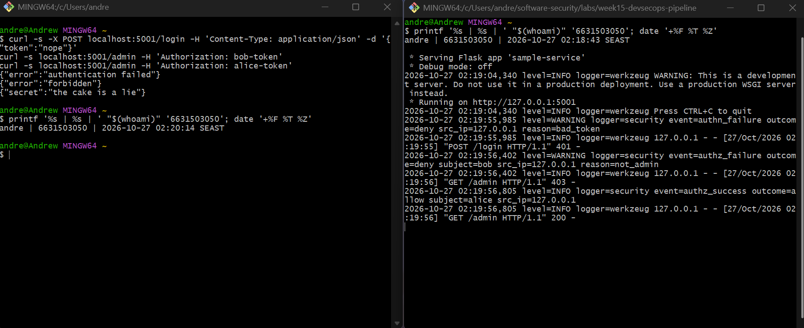
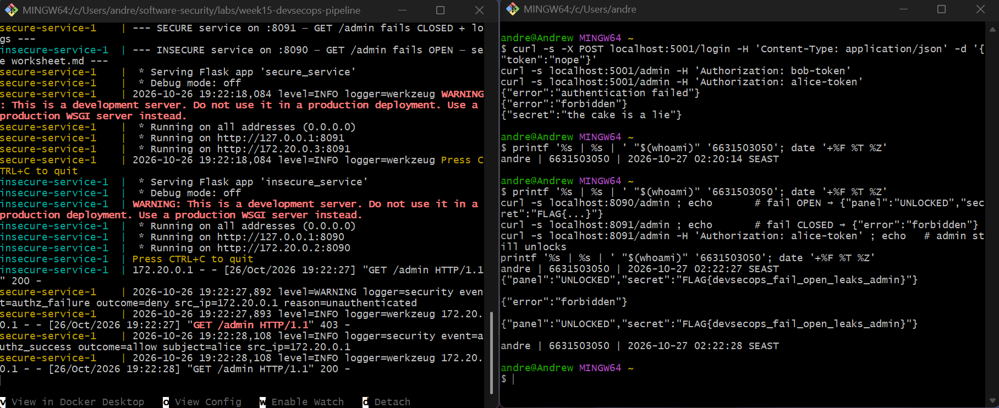
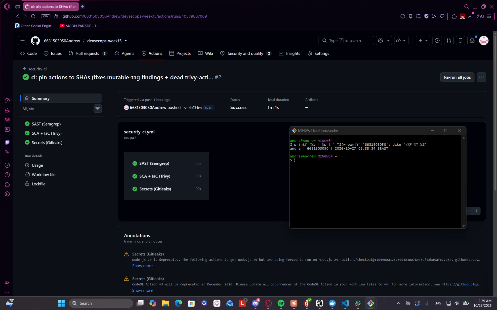
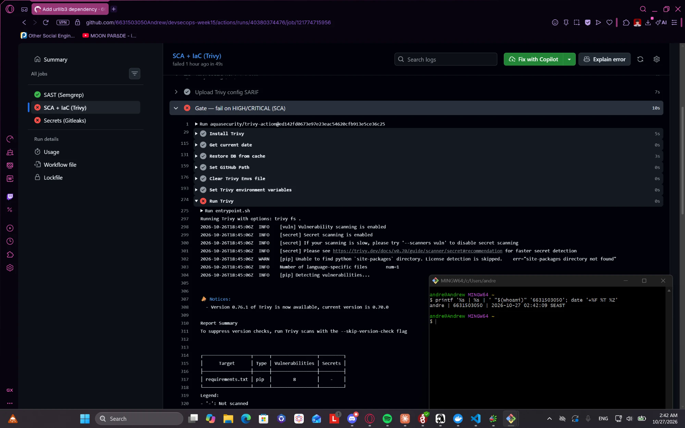

# Worksheet 15 — DevSecOps: Putting It Together (4 hrs)

> **Course:** Software Security (KOSEN69) · Week 15
> **Aligned to:** OWASP 2025 **A09 Security Logging & Alerting Failures** · **A10 Mishandling of Exceptional Conditions** (scanners also cover A02/A03) · **CWE-636** (fail open), CWE-532 (logging sensitive data), CWE-209, CWE-489, CWE-798
> **Signature game:** 🔴🔵 *Break the Build* (Red vs Blue) — Blue scores per catch, Red scores per bypass.

> ⚠️ **Ethics note:** The pipeline and `sample-service.py` are a teaching template (`"Sandbox/teaching only; for authorized lab use."`). Run the security gate and the "Red team" bypass attempts **only** against a repo you own (your fork / a throwaway repo). Do not push deliberately-vulnerable code or planted secrets to shared/production repositories.

---

## Part 1 — Student Information

| Name | Student ID | Date | Group | AI use |
|------|-----------|------|-------|--------|
| Andrew Dicesare | 6631503050 | 10/27/2026 | Let me eat | AI assistant used as a working aid only — full disclosure in the note below this table |

*AI use, in full:* I used an AI assistant to help draft and refine the written answers (Part 2, Part 4, the
remediation notes, the **Audit the AI** / **Prompt Problem** sections) and to help set up my own standalone
public repo for the CI gate — **https://github.com/6631503050Andrew/devsecops-week15** — where I wired the
pipeline, hardened it to a green build, and opened the Red-team defect PRs. I ran the local services, read
each scan, decided the fixes, and captured every screenshot myself; the reasoning and conclusions are mine.

> **Repo note (per instructor):** the CI-gate half of this lab lives in a **standalone public repo with the
> lab files at the repo root** (not the course fork), so the workflow runs from `.github/workflows/` and the
> Red-team defect PRs stay inside my own repo — `6631503050Andrew/devsecops-week15`. The local
> fail-open/fail-closed services (Tasks 0/1/1b) are run from the course lab folder.

---

## Part 2 — Lecture Questions

Answer in your own words (2–4 sentences each).

1. `README-pipeline.md` says each tool runs **twice** (report step, then gate step). Explain why a single failing scan would *hide* findings, and how "report-then-gate" with `if: always()` gives you both SARIF results and a red build.

   **A:** If one step both scanned **and** failed the build on findings, the job would abort at that step — so the **SARIF upload never runs**, and the findings never reach the Security tab (you get a red build with no visibility into *why*). "Report-then-gate" splits this: a **report step** (`exit-code: 0` / `|| true`) produces the SARIF and uploads it with **`if: always()`** so the upload runs *even when a later step is going to fail*; then a separate **gate step** (`exit-code: 1` / `--error`) re-runs and actually fails the build. That ordering gives you **both** — the findings are visible in the Security tab **and** the build goes red — instead of having to choose one.

2. What is the difference between **fail-closed** and **fail-open**? In `sample-service.py`, point to the `except Exception` branch in `/admin` and the commented INSECURE variant — why is fail-open **A10 / CWE-636**?

   **A:** **Fail-closed** means that when something goes wrong (an error/exception), the system defaults to the **secure** state — it **denies**. **Fail-open** defaults to the **insecure** state — it **allows**. In `sample-service.py`'s `/admin`, the `except Exception as exc:` branch logs the error type and `return jsonify(error="forbidden"), 403` — it **denies on any error** (fail-closed). The commented INSECURE variant, `except Exception: return jsonify(secret="the cake is a lie")`, **grants** access on error (fail-open). Fail-open is **A10 Mishandling of Exceptional Conditions / CWE-636 (not failing securely)** because any error path — a bug, a malformed request (`KeyError` on a missing token), a crash — becomes an **authorization bypass**: the attacker just triggers an exception and is let in. The secure default is to deny.

3. The `permissions:` block in `security-ci.yml` is `contents: read`, `security-events: write`. Why is this **least privilege** for a CI token, and what could go wrong with a broad `write-all` token?

   **A:** The workflow only needs to **read the code** (to scan it) and **write security events** (to upload SARIF to the Security tab) — nothing else. Scoping the `GITHUB_TOKEN` to exactly those two permissions is least privilege: if the workflow or any action/dependency it runs is compromised, the token **can't push commits, cut releases, edit issues, publish packages, or reach other write APIs**. A broad **`write-all`** (or the default write) token turns a scan job into a **supply-chain foothold** — a poisoned action or an injected step could tamper with `main`, push malicious code, create releases, or exfiltrate via the write APIs. Least privilege caps the blast radius of a compromised CI run.

4. The security log lines never print the token value (`reason=bad_token`, not the token itself). Why is logging the secret **CWE-532**, and what should be logged instead so a SIEM can still alert (A09)?

   **A:** Logging the actual token/password is **CWE-532 (insertion of sensitive information into a log)** because logs are usually **less protected than the secret store** — they're shipped to a SIEM, readable by ops, retained for years, and indexed — so the credential leaks to everyone with log access and a log breach becomes a **credential breach**. What should be logged instead (so a SIEM can still detect and alert — A09): the **event** (`event=authn_failure`), the **outcome** (`outcome=deny`), the **subject** where known (`subject=alice`), the **source** (`src_ip`), and a **non-sensitive reason** (`reason=bad_token` / `reason=not_admin`) — enough to spot brute-force, credential-stuffing, and privilege-escalation attempts, **without ever recording the secret**. The code also logs `error=type(exc).__name__`, not the exception message (CWE-209).

5. Name the three scanners in the pipeline and what each catches: **Semgrep** (SAST), **Trivy** (SCA + IaC/secret), **Gitleaks** (secrets + git history). Which OWASP categories does each map to per the README table?

   **A:**
   - **Semgrep (SAST)** — scans **source code** for insecure patterns using the OWASP rulesets (`p/default`, `p/owasp-top-ten`); maps to the **OWASP Top 10** code rules.
   - **Trivy (SCA + IaC)** — scans **dependencies** for known CVEs (SCA → **A03 Software Supply Chain**) and **Dockerfiles / IaC** for misconfigurations (→ **A02 Security Misconfiguration**), and can flag secrets.
   - **Gitleaks** — scans the repo **and full git history** (`fetch-depth: 0`) for **hard-coded secrets / credentials** → **CWE-798**.

---

## Part 3 — Hands-on Lab

> **Where each half runs:** the **local services** (Tasks 0, 1, 1b) run from the course lab folder
> (`labs/week15-devsecops-pipeline/`). The **CI gate** (Tasks 2–5) runs in my standalone repo
> **[`6631503050Andrew/devsecops-week15`](https://github.com/6631503050Andrew/devsecops-week15)** with the
> lab files at the root. Each task below embeds its identity-stamped screenshot as evidence.


### Task 0 — Onboarding (15 min)
Run the sample service; trigger the three curls.

  **Commands:**
  ```bash
  pip install flask
  python labs/week15-devsecops-pipeline/sample-service.py
  # in another shell:
  curl -s -X POST localhost:5001/login -H 'Content-Type: application/json' -d '{"token":"nope"}'   # 401
  curl -s localhost:5001/admin -H 'Authorization: bob-token'    # 403
  curl -s localhost:5001/admin -H 'Authorization: alice-token'  # 200
  ```
  **Expected structured security log lines (`event=…`):**
  ```
  … logger=security event=authn_failure outcome=deny src_ip=127.0.0.1 reason=bad_token
  … logger=security event=authz_failure outcome=deny subject=bob src_ip=127.0.0.1 reason=not_admin
  … logger=security event=authz_success outcome=allow subject=alice src_ip=127.0.0.1
  ```
  

### Task 1 — Logging & fail-closed (35 min, A09/A10)
  **Fail-closed explanation (2–3 sentences):** In `sample-service.py`, `/admin` wraps the auth check in `try/except`, and the `except Exception as exc:` branch **returns 403, never the secret** — so if any unexpected error occurs (a malformed header, a bug), access is **denied by default** (fail-closed, A10/CWE-636). It logs `error=type(exc).__name__` (the exception *class*, e.g. `KeyError`) rather than the exception message, so an internal detail/stack trace never leaks to the client (**CWE-209**). The line that would make it fail **open** is the commented INSECURE variant — `except Exception: return jsonify(secret="the cake is a lie")` — which grants access on error instead of denying.

  

### Task 1b — Break the Build, live (25 min, A10 / CWE-636)
Exploit the real fail-open, then prove the fix.

  **Commands:**
  ```bash
  cd labs/week15-devsecops-pipeline && docker compose up    # insecure :8090 / secure :8091
  curl -s localhost:8090/admin                                 # fail OPEN — leaks the panel + flag
  curl -s localhost:8091/admin                                 # 403 fail CLOSED + logged
  curl -s localhost:8091/admin -H 'Authorization: alice-token' # still UNLOCKS for a real admin
  ```
  **Contrasting `/admin` responses:**
  ```
  :8090 (insecure, NO auth header) -> {"panel":"UNLOCKED","secret":"FLAG{devsecops_...}"}   <- fail OPEN
  :8091 (secure,   NO auth header) -> {"error":"forbidden"}                                  <- fail CLOSED (403)
  :8091 with Authorization: alice-token -> {"panel":"UNLOCKED","secret":"..."}               <- admin still works
  ```
  **The exact fail-open line (`insecure_service.py`):** the `/admin` handler does `user = USERS[token]` (dict **indexing**), which raises `KeyError` on a missing/unknown token; the `except Exception:` block then **`return jsonify(panel="UNLOCKED", secret=SECRET)`** — it swallows the error and grants access. The fix (`secure_service.py`) is `USERS.get(token)` (returns `None`, never raises) + an `except` that **denies** (403) and logs.

  **Flag:** the local service leaks the **demo** flag `FLAG{devsecops_fail_open_leaks_admin}` (same for everyone). My **graded** flag, from the **Break the Build challenge on `ctf.zcr.ai`**, is recorded on the Personalized-flag line below.

  

### Task 2 — Stand up the gate (35 min)
Get the workflow running.

  **What I did:** created a standalone public repo, put the lab files at the root, and copied the gate to `.github/workflows/security-ci.yml`:
  ```bash
  gh repo create devsecops-week15 --public
  # .github/workflows/security-ci.yml + secure_service.py + sample-service.py + requirements.txt
  git push -u origin main    # runs security-ci on push/PR to main
  ```
  **Result:** the `security-ci` workflow runs the three jobs — **`semgrep` (SAST)**, **`trivy` (SCA + IaC)**, **`gitleaks` (secrets)** — and each tool's report step uploads **SARIF to the repo's Security tab** (Code scanning alerts). Repo: `6631503050Andrew/devsecops-week15`.

  

### Task 3 — Blue team: pass the gate (30 min)
A green build.

  **What I did (the right way — fix/justify, no blanket-ignore):** the first run failed because (a) Trivy's pinned action `@0.24.0` no longer exists, and (b) Semgrep raised 12 blocking findings (11 × mutable-action-tag on the workflow's `@v4`/`@v3` tags + 1 × Flask `host="0.0.0.0"`). I **pinned every GitHub Action to a commit SHA** with a `# vX` comment (the real supply-chain fix for mutable-action-tag — and it bumped Trivy to the current `@v0.36.0`), and **justified** the intentional host bind with a documented, rule-specific `# nosemgrep: … -- intentional: binds all interfaces for Docker; scan-only here`.
  **Result:** green build — `semgrep ✓ / trivy ✓ / gitleaks ✓`.

  **Passing run:** `https://github.com/6631503050Andrew/devsecops-week15/actions` (the green `security-ci` run on `main`).

  

### Task 4 — Red team: Break the Build (40 min)
Make the gate say **no** — one planted defect per PR, each caught by a different job.

  | PR | Planted defect | Job that catches it | Enforcing step |
  |----|----------------|---------------------|----------------|
  | **#1** [`red/vuln-dep`] | `urllib3==1.26.4` added to `requirements.txt` (outdated, known CVEs) | **Trivy SCA** (`trivy fs`) | `Gate — fail on HIGH/CRITICAL (SCA)` · `exit-code: "1"` |
  | **#2** [`red/root-dockerfile`] | Dockerfile with **no `USER`** (runs as root) | **Trivy config** (IaC) | `Gate — fail on HIGH/CRITICAL (IaC)` · `DS-0002` HIGH · `exit-code: "1"` |
  | **#3** [`red/hardcoded-secret`] | hard-coded API key in `config.py` | **Gitleaks** (`generic-api-key`) | `Gate — fail if any secret found` · `--exit-code 1` |

  Each PR turns its gate red, and the **intended** job catches each defect (verified on the real runs: Trivy SCA flagged `urllib3`, Trivy config flagged the root Dockerfile as `DS-0002` HIGH, Gitleaks flagged `config.py`'s `INTERNAL_API_KEY`). **Overlapping coverage (defense in depth):** PR #2's missing `USER` is *also* caught by **Semgrep** (`dockerfile.security.missing-user`) — two scanners, same defect — which is a feature, not a bug. (Per README §5: **not** `chmod 777` or `:latest` — those are MEDIUM/none and slip a `HIGH,CRITICAL` gate; root is `DS-0002` HIGH and fails for real.)

  

### Task 5 — Score Break-the-Build (25 min)
  **Scoreboard:** **Blue 3 – Red 0.** Each of the three planted defects was caught by its gate (urllib3 → Trivy SCA; root Dockerfile → Trivy config DS-0002; hard-coded key → Gitleaks); none slipped through, so Red scored no bypass points.
  **One proposed gate improvement:** add the **optional image scan** (build the image, `trivy image … exit-code: 1`) so CVEs in the *base image* (not just declared deps) also fail the build — today a vulnerable base layer could pass. (A second option: lower Semgrep/Trivy to also surface MEDIUM for review, since a MEDIUM `DS-0001 :latest` currently slips the HIGH,CRITICAL gate — a known Red avenue.)

---

## Part 4 — Reflection

1. **Mapping.** For three controls you exercised, give: control → A09/A10 (or A02/A03 for a scanner) → CWE → one-line rationale.

   **A:**

   | Control | OWASP 2025 | CWE | Rationale |
   |---------|-----------|-----|-----------|
   | Fail-closed `/admin` (`except → 403`) | **A10** Mishandling of Exceptional Conditions | CWE-636 | Errors deny by default, so a bug/crash can't become an auth bypass |
   | Structured security logging (`event=…` to a dedicated logger, no secret) | **A09** Logging & Alerting Failures | CWE-778 / CWE-532 | Auth events are recorded and SIEM-alertable, without logging the credential |
   | CI gate fails on HIGH/CRITICAL (Trivy SCA/config, Gitleaks) | **A03 / A02** | CWE-1104 / CWE-732 / CWE-798 | Vulnerable deps, root containers, and secrets are blocked before they reach `main` |

2. **Real incident.** Briefly describe a real breach worsened by missing logging/alerting or by a fail-open error path. Which control here would have changed the outcome?

   **A:** The **2017 Equifax breach** (~147M people) began with an **unpatched known CVE in Apache Struts (CVE-2017-5638)** left vulnerable for months — exactly what an **SCA gate like Trivy** here would have flagged and blocked (A03). It was then *worsened* by an **A09 logging/alerting failure**: an **expired certificate** had blinded their network-traffic inspection for ~19 months, so the attackers exfiltrated data **undetected for ~76 days**. Two controls from this lab would have changed the outcome: the **SCA gate** (catch and block the vulnerable Struts dependency before deploy) and **working security logging/alerting** (detect the anomalous exfiltration instead of running blind). The breach is a textbook A03-prevention-plus-A09-detection failure.

3. **Best mitigation.** Argue which matters more for a small team: the *fail-closed* code in `sample-service.py`, or the *CI gate* in `security-ci.yml` — and why both together beat either alone.

   **A:** They defend **different stages**: the **CI gate** protects **build time** — it automatically blocks whole classes of known-bad (vulnerable deps, secrets, root containers, misconfig) on *every* PR, cheaply and at scale, so for a small team it's the higher-leverage *preventive* control. But a gate only catches what the scanners **know** — it won't reliably catch a custom **logic** flaw like fail-open in your own auth code. The **fail-closed** pattern protects **run time** — it's the last line of defense that contains the *unknown* errors the gate can't predict, ensuring a bug denies rather than leaks, and it costs almost nothing to write. So if forced to pick one, the small team takes the **CI gate** (most coverage per unit of effort); but the two together are strictly better — the gate stops known-bad from merging while fail-closed handling contains the runtime surprises the gate misses. That's defense in depth across build- and run-time.

---

## Grading rubric (100)

| Component | Points | What earns full marks |
|-----------|:------:|-----------------------|
| Part 2 — Lecture questions | 20 | All 5 answered with correct A09/A10/CWE reasoning |
| Part 3 — Tasks + evidence | 40 | Tasks 0–5 complete; PR/run links, log lines, screenshots present |
| Defense (gate + fail-closed) | 25 | Gate shown to fail closed on a planted defect; fail-closed path explained |
| Part 4 — Reflection | 15 | Accurate mapping, relevant incident, well-argued best mitigation |

---

## Evidence & Integrity (required)

- **Identity proof:** every screenshot/diagram must show a terminal running `printf '%s | %s | ' "$(whoami)" '<YOUR-STUDENT-ID>'; date '+%F %T %Z'` **in the
  same image as the evidence**. When the evidence is a browser page, a DevTools panel or a
  rendered response, put that terminal **beside the browser and capture the whole screen** — a
  cropped window carries nothing that identifies you, and the lab's own output is
  byte-identical for the whole cohort *by design*, so the stamp is the only thing that makes
  the shot yours. Generic or borrowed evidence is not accepted.
  *The CI screenshots (Tasks 2–4) put a stamped terminal beside the GitHub Actions / Security / PR page; the
  local service shots (Tasks 0/1/1b) run the stamp in the same shell as the `curl`s.*
- **Personalized flag (graded):** `FLAG{devsecops_3ae47bf8e2d84a1b}` — captured from **my own instance of the Break the Build challenge on `ctf.zcr.ai`** (the graded flag, per the course instructions). The local insecure service leaks the **demo** flag `FLAG{devsecops_fail_open_leaks_admin}` (the same for everyone — shown in Task 1b to prove the fail-open bypass), which is **not** the graded value.
  *Flags are unique per student — submitting another student's flag is a violation. How to submit: **learn.zcr.ai/submit** (full guide: `SUBMISSION.md` in the repo root).*
- **Explain in your own words** *(graded on your reasoning, not copied text):*
  1. What did you do, and **why did the vulnerability work**?

     **A:** I showed an admin endpoint that **fails open** — sending no/bad token raises an error, and the broken `except` block hands back the admin panel and the flag — then proved the hardened version denies and logs. On the pipeline side I built a security CI gate (Semgrep/Trivy/Gitleaks) that fails the build on HIGH/CRITICAL, got it green, then opened PRs that each sneak in one defect. The vulnerability "works" because safe defaults were flipped: an error path **granted** instead of **denied**, so a trivial bad request became an auth bypass.
  2. **Why does your fix actually stop it** — and what could still break it?

     **A:** The secure service uses `.get()` (no exception to swallow) and an `except` that **denies + logs**, so there's no error path that grants access; and the CI gate blocks vulnerable deps, root containers, and secrets before they reach `main`. What could still break it: the gate only catches what the scanners *know* — a novel logic bug (another fail-open elsewhere) can pass Semgrep, a MEDIUM finding (`:latest`) slips the HIGH,CRITICAL threshold, and a secret added and then *removed* in the same PR can still live in history; so the gate needs tuning + the fail-closed pattern applied everywhere, not just this one route.

---

## 🤖 Audit the AI (required)

AI is a power tool you must **distrust** — you are graded on your *critique*, not the AI's answer.

1. Ask an AI assistant to exploit **or** fix this week's vulnerability. Paste its full answer.

   **AI answer (adding a "security gate" to CI):**
   ```yaml
   - name: Security scan (Trivy)
     uses: aquasecurity/trivy-action@master
     with:
       scan-type: fs
       severity: HIGH,CRITICAL
     continue-on-error: true    # keep the pipeline moving
   ```
   > "This adds Trivy to CI and reports HIGH/CRITICAL vulnerabilities on every build."

2. **Find what's wrong or risky** in it — insecure code, a subtly incomplete fix, a hallucinated API/function/CVE, a missed edge case, or wrong reasoning. Quote the exact line(s).

   **A:** It's a **decorative gate — it can never say no.** `continue-on-error: true` makes the step's failure **not fail the build**, so a HIGH/CRITICAL vulnerable dependency merges **green** — the exact anti-pattern `README-pipeline.md` warns about ("Real gates must be able to say **no**"). It's a *report*, not a *gate*. Two more problems: **`@master`** is a **mutable action tag** (supply-chain risk — the action can change under you; it should be pinned to a commit SHA), and there is **no SARIF upload**, so the findings never appear in the Security tab (no visibility). Quote: `continue-on-error: true    # keep the pipeline moving`.

3. Produce the **correct, verified** version yourself and explain in 2–3 sentences why the AI's output was insufficient.

   **Correct version (report-then-gate, SHA-pinned):**
   ```yaml
   # report step — upload SARIF even if the build will fail
   - name: Trivy fs (SCA) -> SARIF
     uses: aquasecurity/trivy-action@ed142fd0673e97e23eac54620cfb913e5ce36c25 # v0.36.0
     with: { scan-type: fs, scanners: vuln,secret, format: sarif, output: trivy-fs.sarif, severity: HIGH,CRITICAL, exit-code: "0" }
   - name: Upload Trivy SARIF
     if: always()
     uses: github/codeql-action/upload-sarif@4bfa242aa49c5f7c6770b98670d354a7dfac05f8 # v3
     with: { sarif_file: trivy-fs.sarif, category: trivy-fs }
   # gate step — THIS one fails the build
   - name: Gate — fail on HIGH/CRITICAL
     uses: aquasecurity/trivy-action@ed142fd0673e97e23eac54620cfb913e5ce36c25 # v0.36.0
     with: { scan-type: fs, scanners: vuln,secret, severity: HIGH,CRITICAL, exit-code: "1" }
   ```
   **Verified:** on my repo I opened a PR adding `urllib3==1.26.4` — the **gate step exits 1 and the PR check goes red**, while the report step's SARIF still shows in the Security tab. The AI's `continue-on-error` version would have let that PR merge green.
   **Why the AI was insufficient:** it confused *running a scanner* with *enforcing a gate* — `continue-on-error: true` reports but never blocks, so vulnerable code still merges; and `@master` + no SARIF upload add a supply-chain risk and remove visibility. A real gate re-runs with `exit-code: 1` and pins its actions to a SHA.

> Disclose your AI use in the Part 1 table. This task counts toward your **Defense + Reflection** score.

---

## 🧠 Comprehension & Prompt (required)

**A. Explain in Plain English (EiPE).** In 2–3 sentences, in your own words, describe what this week's vulnerable code/endpoint actually *does* and *why it is exploitable* — explain the mechanism, don't dump jargon.

**A:** The admin page checks your token, but if anything goes wrong while checking it, the broken "oops" handler **lets you in instead of keeping you out** — so you just send a bad or empty token, it errors, and the error-handler hands you the admin panel and its secret. On the pipeline side, a "security gate" that's set to *keep going on failure* only pretends to check, so vulnerable code or secrets sail straight through. Both are exploitable for the same reason: the **safe default was flipped** — errors should *deny* and gates should *block*, and when they don't, a trivial mistake becomes a wide-open door.

**B. Prompt Problem.** Write a **single prompt** that makes an AI produce a *correct, secure* fix for one finding. Run it: does the exploit now fail? If not, refine the prompt and try again. Submit the **final prompt + the verified result**.

**Final prompt:** "Write the GitHub Actions steps for a Trivy dependency-scan **gate** that **actually fails the build** on HIGH/CRITICAL findings — do **not** use `continue-on-error` or `|| true`. It must still **upload SARIF to the Security tab even when the build fails** (`if: always()`), and every action must be **pinned to a commit SHA**, not a mutable tag like `@master` or `@v1`. Return the report step + the gate step."
**Verified result:** the AI returned a **report step** (`exit-code: "0"` + `if: always()` SARIF upload) and a separate **gate step** (`exit-code: "1"`), both SHA-pinned. I tested it by opening a PR that adds `urllib3==1.26.4`: the **gate step failed the PR (red)** while the SARIF still appeared under Code scanning — so the "vulnerable dep merges green" exploit now fails. Naming "do not use continue-on-error / || true" and "pin to a SHA" is what stopped the AI from regressing to the decorative-gate answer from the Audit section.
*Graded on the prompt's precision and your verification — this trains problem decomposition and AI literacy (Denny et al. 2024).*
